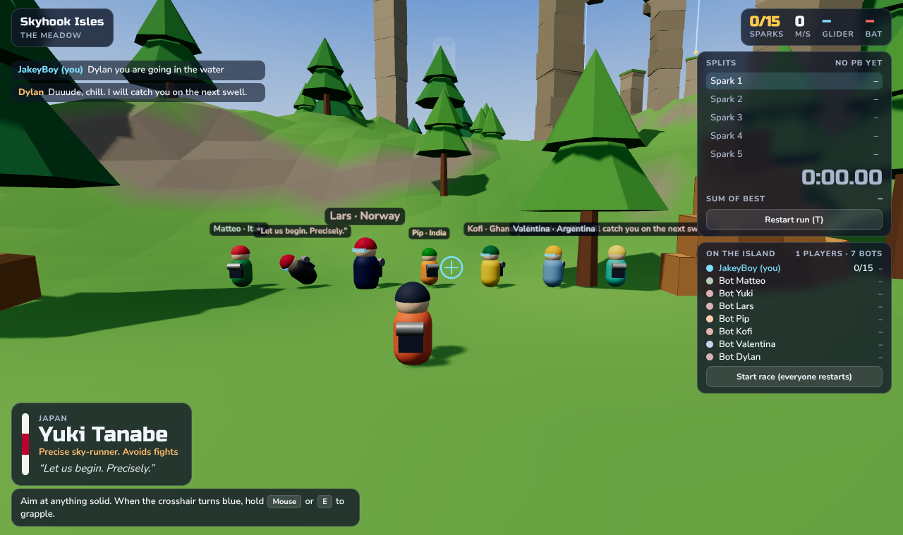
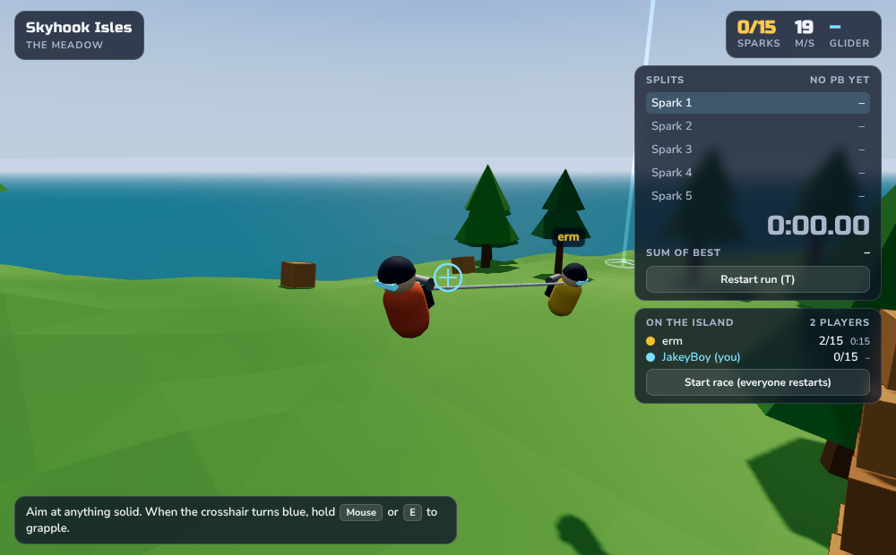
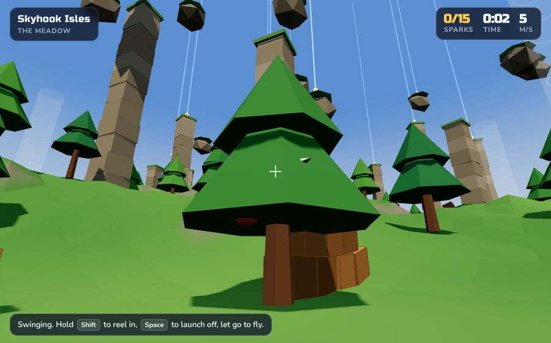
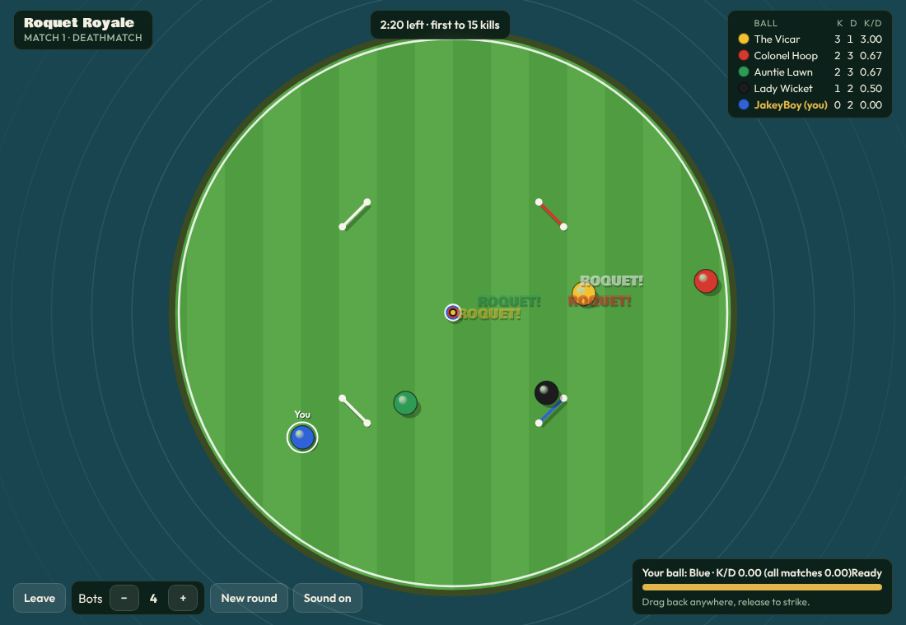

# Design log

Everything built in cOOL-gAMEZ, newest first. Screenshots live in `docs/img/`. Regenerate the current Skyhook ones with `node tools/screenshots.js`.

---

## 2026-11-14: Skyhook Isles, map system, chat, outer islets

**Restructure.** The game was one 1,500-line HTML file. It's now split:
- `index.html`: page, styles, HUD
- `js/main.js`: engine: rendering, physics, player, multiplayer, bots, audio
- `js/lib.js`: shared noise and math helpers
- `maps/*.js`: one file per map (terrain height, colors, sky, objects), listed in `maps/index.js`

Maps are picked by URL hash (`#map-isles`) for now. The artifact publishes the extra files alongside the page.

**Expanded Skyhook Isles.**
- The world grew from 240 m to 320 m square.
- Five outer islets, mostly on the far side from spawn, each with a pillar.
- A ring of 18 floating catch-rocks just off the coast, plus stepping rocks out to each islet, so a knock-off or a missed swing can be saved.

**Chat.**
- Enter opens text chat. Hold V (or the Mic button) for voice: the dictation capability turns speech into text.
- When you chat with bots around, the bot you name (or a random one, about 40% of the time) answers in character. The line is written by Claude via the sample capability, spoken in their voice, and shared with friends.

**New character.** Dylan "Swell" Hayes from California: a chill surfer who rides ropes and rarely starts fights. Entrance move: shaka sway.

## 2026-11-14: Skyhook Isles, bots become a cast of characters

Six original characters, each with a nationality, colors, entrance card and move, voice, catchphrases and AI traits (aggression, fear, grapple use, dodge, knockback, grudges). They were inspired by the casts of *Sports Champions* and *Rockstar Table Tennis*. Bots run on one player's game and are shared through presence, with handover when that player pauses or leaves.

## 2026-11-14: Skyhook Isles, combat, sound, music, announcer, tooling

- **Combat:** shove (F) plus a baseball-bat power-up. Hits are numbered events the target applies to itself. Sea dunks are credited to the last hitter within 8 s.
- **Sound effects:** synthesized live.
- **Music:** an original procedural 132 BPM techno track (acid bass, stabs, breakdowns).
- **Announcer:** Claude's voice, or the browser's speech voice, replaceable by recorded clips.
- **Tooling:**
  - `tools/harness.js` serves the repo, swaps the CDN for local libraries, and fakes the multiplayer room.
  - `npm test` runs the regression checks.
  - `npm run voice` bass-boosts announcer recordings with ffmpeg.

## 2026-11-14: Skyhook Isles, multiplayer

Each player runs their own physics and shares a pose about 20 times a second. You can grapple your friend, which pulls both of you. A Start race button gives everyone a 3-2-1 countdown.

## 2026-11-14: Skyhook Isles, movement fixes, glider, speedrun splits

- **Jitter fix:** render interpolated physics poses.
- **Hover ground controller:** replaced the collision sphere scraping over terrain triangles. Vertical speed went from swinging −14 to +2 m/s to staying between −1.7 and +2.5 m/s.
- **Glider power-up:** hold Space while falling. Dive to gain speed; updrafts give lift.
- **LiveSplit-style timer:** per-spark splits, gold segments, a live delta, and sum of best.

 

## 2026-11-14: Skyhook Isles, first playable

A third-person 3D grapple game built with Three.js and cannon-es: a generated island, pillars, floating rocks, updrafts and 15 sparks. The rope is a one-sided constraint, and the pull is shared by mass, so crates get yanked and the boulder doesn't.

 

## 2026-11-14: Roquet Royale

A 2D croquet battle royale for the claude.ai artifact room. The host simulates and shares snapshots.
- Free-for-all, with a shrinking lawn.
- Co-op vs bots, with team rings.
- Deathmatch, with K/D.
- Death Run, with a rotating trapper and five traps.
- Ping display.

   

---

## Next up

1. Four themed maps, including a rainy Hong Kong-style city.
2. Cups: pick a pack of 3 maps, with points across them.
3. Leaderboards with initials, shared through the artifact database.
4. Character select, plus a Doom-style reacting face in the HUD.
5. Mario Kart-style race items: a "blue shell" that hunts the leader, and bombs that blow holes in buildings (destructible structures).
6. Graphics push (bloom, water, rain, quality setting).
7. Smarter bots that actually grapple across the map and collect sparks.
