# Design log

Everything built in cOOL-gAMEZ, newest first. Screenshots live in `docs/img/`. Regenerate the current Skyhook ones with `node tools/screenshots.js`.

---

## 2026-11-17: Fair start: everyone frozen during the countdown

- Owner's report: bots could move during the 3-2-1 countdown. Now bots stand still until GO, just like you: no running, hooks, items or attacks. Gravity still works, so nobody hangs in mid-air.
- Bots also move to the start when a race begins. In a race they line up beside the spawn (alternating left and right of you, about 1.8 m apart). In a deathmatch they drop onto random dry land, like you do. Friends were already frozen by their own game.
- Test: during the countdown a shoved bot and a player holding W both stay put, and the bots start on land. Bot bench unchanged (134).

---

## 2026-11-17: Human missile power-up

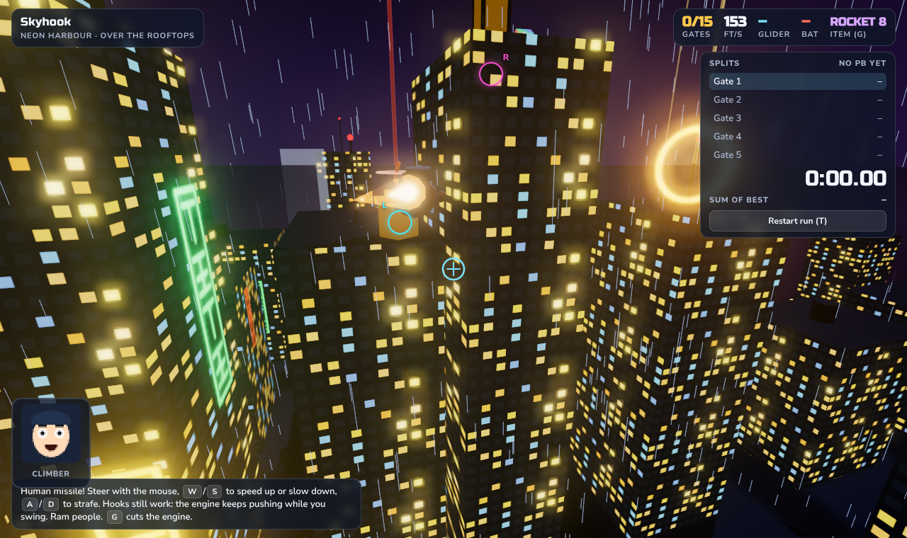

- **New item, the human missile** (from ? boxes, more often when you're behind in a race). For 9 s you fly where you look at a 30 m/s cruise. **W** speeds you up to 46 m/s and **S** slows you to 12 (stick forward and back on touch). **A/D** strafe. The engine holds up most of your weight, so you fly level, and it skims you over the ground instead of ploughing in. Pressing **G** again cuts the engine. Afterwards the speed cap eases back down instead of snapping, so you keep the momentum.
- **Why it feels different:** off a rope, your sideways speed bleeds into the heading, so you carve turns like a missile instead of drifting. On a rope, the engine drives the swing: it pushes along your arc, tilted toward where you look, so you whip around the anchor at full speed instead of dangling. Let go at the right moment to sling yourself out. That's the skill part (principle 2b: easy to fly, deep to master).
- **Ram:** hitting someone above 20 m/s slams them like a dive bomb ("ROCKET RAM!"). A hit that ragdolls you makes the engine sputter until you recover.
- **Looks and sound:** a superman pose along your flight line, a flickering flame from your feet, a low engine drone that rises with speed, and the speed-FOV kick. Friends see the pose and flame (presence `rk`). Bots don't use it yet.
- Numbers in `TUNE.rocket`. Tests: cruise ~30 m/s and level, W reaches 46, S drops to 12, a 90° look turns the heading, a rope swing stays above 15 m/s on the rope, the flag is shared, and it runs out. Fixed three flaky tests along the way: the bot-chase test now starts from a fixed flat spot, the rocket test stops you before moving on, the friend-nuke test waits until its baseline has been seen, and the bot-daze test clears any shield the bot picked up.

---

## 2026-11-17: Left click throws your first rope

- Owner's request: when no rope is out, **left click** throws the left grapple (same as Q), and holding it reels you in. With a rope already out, left click only reels, as before. Nothing else changed: Q/E throw, left/right click reel, Z/C pull, Shift/Left Alt let go, Space drops both.
- The owner's new tenet went into the design principles as 2b, "Easy to pick up, deep to master": the simple action works on the most obvious input, and the full per-rope layout stays for precise players.
- Tests: left click throws with no rope out and only reels with one out. The bot-chase test turned out to be flaky because a bat pickup nearby made the bot detour; bats are out of play during that test now.

---

## 2026-11-17: PC keys rebind: Q/E throw, mouse buttons reel, Z/C pull

- Owner's request: **Q** throws the left grapple and **E** the right one (at the L and R markers, or exactly at the crosshair). Holding **left click** reels you in on the left rope and holding **right click** on the right one. **Z** pulls the left rope's catch to you and **C** the right's. **Shift** and **Left Alt** still let go of the left and right rope, and **Space** lets go of both.
- Clicking no longer throws a rope, so a click with no rope out does nothing (the first click still captures the mouse). Holding both buttons still reels both ropes straight into a tightrope.
- Hints, the Controls panel and the README show the new keys. Tests: E throws, a chorded right click reels and releasing stops reeling, Q throws at the L marker, Z and C pull separately. The bot-chase test now runs 3 s, because a random dodge made it flaky at 2 s.

---

## 2026-11-16: Deathmatch upgrades: Rock Garden, streaks, the nuke, stacking daze, bots on tightropes

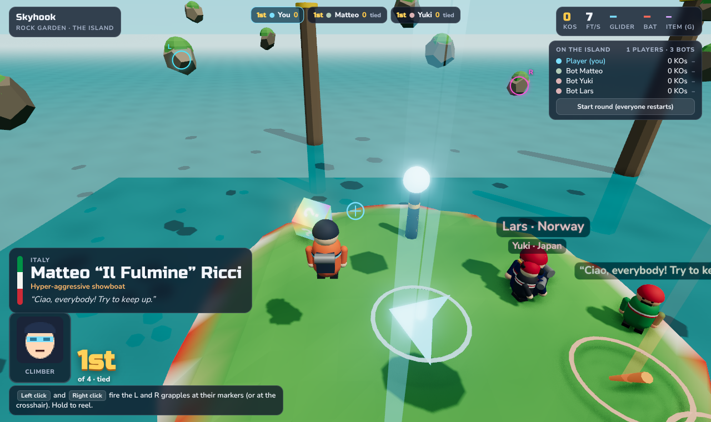

- **Rock Garden** (new deathmatch arena): a small grassy island in a turquoise lagoon under a cloud of 50 little floating rocks in three rings (10 to 26 m up), plus a few right over the island and six tall posts out in the water. Every rock is a hook point, so fights spill into the air. It has the storm-horn trap. Spawns now fall back to spots close in when a map has no land 14 m out.
- **The clock:** deathmatch rounds now run 5:00 with no KO limit by default (custom games can still pick 3 to 20 KOs, or 1:30 to 7:00). There's a one-minute warning and a beep for each of the last ten seconds, in races too.
- **Streaks, called to the whole match** in their own banner under the timer, so they never stomp the normal pop-ups: 3, 5, 10, 15, 20 and 25 KOs in a row (On a roll, Heating up, Unsinkable, Tidal wave, Sea monster, Kraken); a Shutdown when a streak of 5+ ends; losing streaks at 3, 5, 8 and 12 falls without a KO (Taking on water, Sinking fast, Fish food, Honorary fish). Everyone shares their two counts in presence (`ks`) and bots share theirs in the bot list, so every screen calls the same thresholds. The names are original, nautical ones. Design principle 6b now notes this exception.

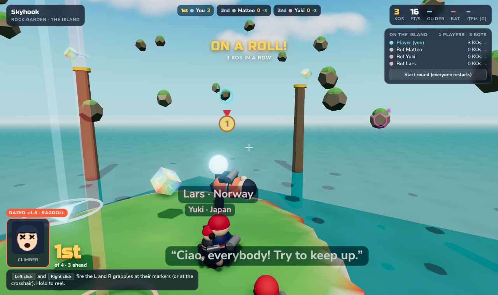

- **The nuke:** 30 KOs in a row during a deathmatch round puts a tactical nuke in your item slot. Dropping it sends a shared numbered event (`nk`). A bomb falls on the middle of the map with a siren, then a white-out flash, a fireball, a shock ring and a mushroom cloud. Everyone else is out with the KO credited to the nuker (through the normal splash and bot-splash events). Every camera pulls back about 110 m to watch it, and 5 s later the round ends with the nuker on top ("You nuked the match!"). Bots can earn and drop it too.

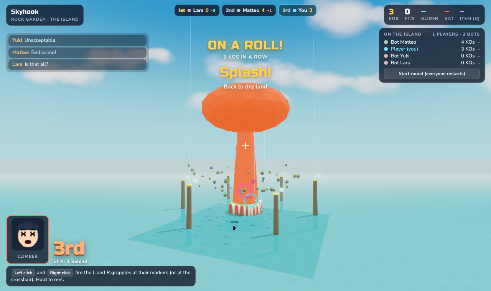

- **Daze stacks:** every hit adds a stack, and the stun lasts ×1, ×1.6, ×2.2, then ×2.8. From the second quick hit on (and always for blasts and boulders), you ragdoll: no hooks, jumps, glider or dive until it wears off. One stack wears off every 5 s and dying clears it. A badge over your face shows "DAZED ×1.6 · RAGDOLL". Bots stack the same way, go limp while ragdolled, and other players see them tumble. All the numbers are in `TUNE.daze`.
- **Bots on tightropes:** a bot chasing someone who is standing on a tightrope hooks the nearest visible point of the rope, reels in fast, climbs on top, and walks the line to them (staying on the centre line), then shoves.
- Tests: a new `tools/test-deathmatch.js` (16 checks) covers the map, the default clock, the streak calls and banner, other players' and bots' streaks, daze timings and ragdoll blocking the hook, decay, bot daze, a bot climbing a tightrope to reach you, earning and dropping the nuke, and the nuke ending the round. `test-skyhook` adds a friend's streak and nuke over the fake room (I'm taken out, with the KO going to them). The sumo test now checks the 5:00 default and a custom KO limit. Bot bench: 134 (was 132).

---

## 2026-11-16: PC grapple controls: L and R hooks with auto-targeting

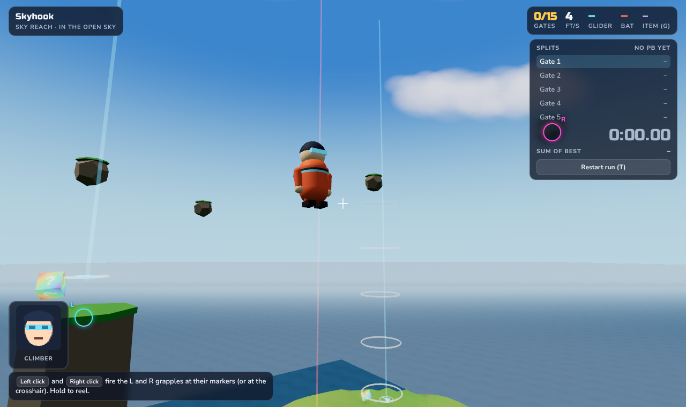

- **Two markers, L (cyan) and R (pink),** always track the best thing to grab on their side of the screen: the nearest rock, pillar, tree, prop, bomb, rope or player in range, favouring what's near your view centre. They only pick targets that are on screen and in line of sight, and they never share a target. When a rope is attached, its marker fills in. They're hidden on touch.
- **The crosshair still wins:** if it's on a grabbable object, the click goes exactly there.
- **Left click** fires the left grapple; keep holding to reel in. **Shift** releases it, and **Q** pulls its object toward you.
- **Right click** fires the right grapple; hold to reel. **Left Alt** releases it, and **E** pulls its object toward you.
- **Space** releases both. Clicking again on a rope that's already attached at that spot just reels instead of refiring.
- Changes: F is now the only attack key (Q pulls), and X no longer fires a hook. Chorded presses (holding one button while you click the other) work for both.
- Tests: the two markers pick different targets, left click fires at L, Shift and Alt release their own rope, chorded right press, Q and E pull separately, Space releases both (75/75 skyhook, 82/82 maps).

---

## 2026-11-15: Bombs in multiplayer: catch a friend's bomb and throw it back

- **Ownership handoff:** every bomb has an id and one owner, who simulates its physics and shares it in presence (`bm`: id, position, velocity, fuse left, last thrower; up to 6). Everyone else draws it as a remote bomb (smoothed, with gravity extrapolation) with the same colour countdown and a hook target.
- **Claiming:** hooking a friend's bomb (main rope or second rope), batting it or shoving it claims it. It becomes a real physics bomb in your game at the same position and speed, with the same remaining fuse, and the hook latches onto it. You announce the claim (`bcl`), and the old owner drops their copy. For 4 s afterwards neither side redraws a stale copy of a claimed id.
- **Blast:** the owner when the fuse runs out sets it off. That goes through the existing shared explosion event, so everyone gets the blast, holes and knockback, and the last thrower gets the credit.
- Bot bombs belong to the player running the bots, so friends can catch those too. A friend leaving or switching maps takes their bombs with them.
- Test (with the scripted fake friend): their bomb appears, claiming it makes it mine and announces the claim, it isn't redrawn as theirs, and when they claim one of mine it leaves my world. Presence is still small (322 bytes).

---

## 2026-11-15: Left and right mouse together, throwable bombs, a 60 s glider

- **Bug (owner): left and right mouse couldn't both hook.** Browsers don't fire `pointerdown` for a second mouse button pressed while another is held (a "chorded" press). It arrives as a `pointermove` whose `button` names the changed button and whose `buttons` mask says whether it's now down. The canvas now handles those for all three buttons (left = main hook when the mouse is captured, right = second rope, middle = attack). Left + X already worked, because keys aren't chorded. Test: a chorded right press with left held fires the second rope, and the chorded release lets it go.
- **Bombs can be grappled and thrown back.** Each bomb has an easy-to-hit 0.9 m hook target. Hook it, Pull it in, then Hit to throw it, or just bat or shove it away. Whoever handled it last owns the blast. Bot bombs work the same way. (Bombs exist in the world of the person who threw them, plus the bot runner's for bot bombs, so in multiplayer you can catch your own and the bots' bombs. A friend's bomb only arrives as its explosion.)
- **Longer fuse with a colour countdown:** the fuse is 4 s (was 1.8; `tuning.js` → `bomb.fuse`). The bomb's glow goes green, yellow, red, blinking faster as it runs down, with an accelerating beep when you're within 40 m, and it swells in the last second. Player and bot bombs now share one `makeBomb()`.
- **Glider lasts 60 s** (was 30; `glider.time`), and the pickup toast shows the real duration.
- Bot benchmark: 132 (was 130). Bots also get the longer glider.

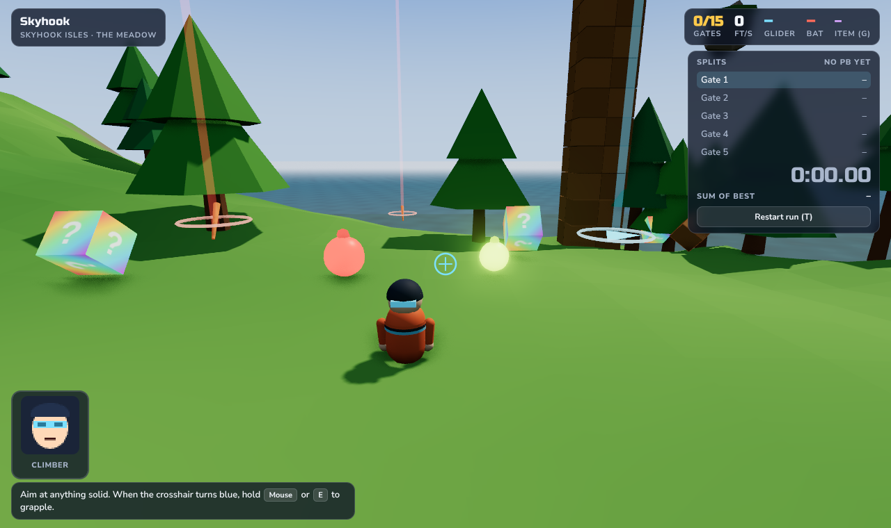

---

## 2026-11-15: Wider look range; a steerable straight-down dive

- **Look further up and down:** camera pitch now goes from -1.1 to 1.45 rad (was -0.55 to 1.25), for mouse, touch and gyro, so you can aim at anchors high above or below you. It's in `tuning.js` → `camera.pitchMin/pitchMax`.
- **Dive, reworked (owner):** holding dive (Shift, Reel, or swipe down and hold) now points you **straight down** at up to 50 m/s. Movement keys or the joystick tip the dive up to 55° in that direction, relative to the camera (`glider.diveTilt`). Letting go swoops you out along your heading: 75% of your speed goes forward (capped at 34) and up to 45% goes into the climb (`pullOut`, `pullUp`). Measured: 49.9 m/s straight down with 0.8 m/s drift, holding W tilts it to 34.6 m/s forward, and release swoops at 33.7 m/s forward and 17.5 m/s up.
- **Dive animation:** you go head-first along the dive line (the body rotates to match the tilt), arms stretched over your head, legs together, wing folded to 22%, with a white speed trail behind you. Friends see the dive pose (`dv` in presence). A dive bomb hit adds a shockwave ring and embers.
- The in-game hints and the controls list describe the new dive.

---

## 2026-11-15: Two ropes on PC

- Two ropes used to exist only in the touch Swing scheme. On PC, **left mouse / E** is still the main hook, and **right mouse / X** now fires a second hook at the crosshair. Hold it to stay attached, release to let go. With both on fixed anchors, hold Shift to reel in until you hang almost straight and they merge into a tightrope. Before this, right mouse was just another button for the main hook.
- Test: aim at a floating rock, fire the second rope, it attaches, and it lets go on release.

---

## 2026-11-15: Grapple onto tightropes; pulling keeps your footing

- **Getting on a tightrope:** the rope now has an invisible 0.5 m sleeve that the hook bites easily. Hooking it hauls you up at 22 m/s (`tuning.js` → `tightrope.climbReel`), and within 2.6 m you climb on top of it at the nearest point. Tested: from 8 m below you're standing on it in about a third of a second.
- **Pulling doesn't lock you:** a hook used to count as "swinging" whatever it was on, which switched off your footing (the ground hover controller and walking). Now, while you hold Pull on a person or a loose object, you keep your footing: you stay on the tightrope (or the ground), can walk, and reel them up to you. Swinging from fixed anchors is unchanged (`swingingNow()` vs `anyAttached()`). Tested: standing on a tightrope, a crate pulled from 12 m to 1.9 m, and you never left the rope.

---

## 2026-11-15: Gates instead of sparks, calmer swing physics, Sky Reach, pinch zoom

- **Race gates:** every race checkpoint is now a big golden ring (about 4 m radius, slowly spinning, with a faint glowing disc) raised 2.2 m above its perch. Passing within 4 m of the centre counts, where the old sparks needed 1.9 m. The final spark is now the **final gate**, a giant ring around the core (grab radius 5 m). The HUD, splits, toasts, results and awards say "Gates" (the Spark Hoarder award is now Gate Crasher). Tuning: `tuning.js` → `gate`.
- **Physics (owner: "insane speed that lets me skip over the entire map"):**
  - Rope over-stretch kick 4 → 1.5 (`rope.stretch`): this was the main source of the huge release speeds.
  - Reel speed 24 → 16, rope jump-off boost 1.12× → 1× and kick 8 → 5.
  - Speed cap 45 → 34 m/s, and new air drag above 22 m/s (sheds 50% of the excess per second, not while glider-diving).
  - Measured: a 60 m/s fling drops to 33.9 m/s at once and 26 m/s after 2 s. Release from a long reel-in swing peaked at 37 m/s instead of 45.
  - Bots use their own rope code, so the bot benchmark is unaffected: 130 (was 129).
- **Sky Speedway removed** (too narrow). The engine features it introduced stay: speed strips, map-ordered sparks and the speed-based field of view.
- **New map, Sky Reach:** six small islands over a 400 m sea, about 100 floating mossy rocks on a sparse jittered grid (about 32 m apart, 26–60 m up), ten sea stacks, updrafts over four islands, and a storm horn. Routes are chains of swings, and the gates sit on rocks and stacks across the whole map.
- **Pinch to zoom** on touch: two fingers zoom the camera between 3.5 and 15 m, the same range as the mouse wheel. A pinch never counts as a tap or look.
- Tests: pinch zoom, gate radius, speed cap and drag (with the coyote ground-grace window allowed to lapse first). Sky Reach goes through the full per-map suite.

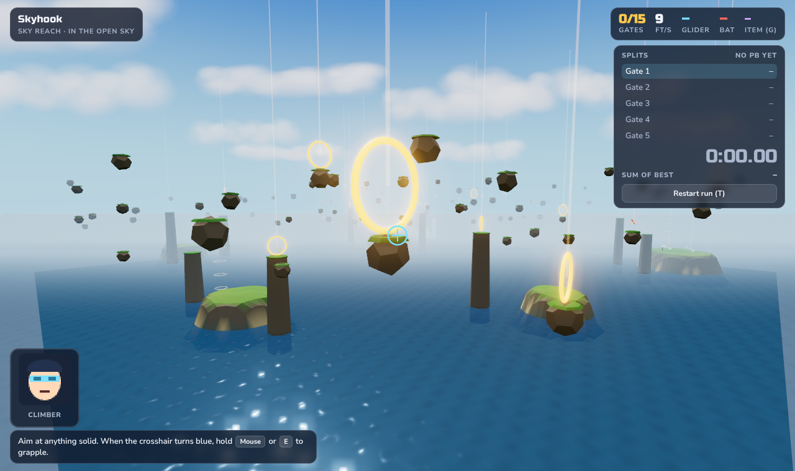

---

## 2026-11-15: Glider dive, character select, tightropes, volume

- **Glider dive (Arkham-style):** while gliding, hold Shift (or Reel, or swipe down and hold on touch) to plunge at a 26 m/s sink and build speed toward 50 m/s (the speed cap rises while diving). Let go to pull up: up to 45% of your speed turns into a climb (max 22 m/s), keeping 85% of the horizontal speed. Ramming someone at over 28 m/s mid-dive is a **dive bomb** (a bat-strength hit). The test measured 45 m/s after a 1.5 s dive and a 17 m/s climb on release. Tuning is in `tuning.js` → `glider`.
- **Character select:** a portrait grid on the start screen (each face drawn with the HUD face renderer, a flag-stripe band, name and home). Picking one plays their catchphrase in a pop-up bubble, their animation on the card (spin, bow, cower, knuckles, pound, dance or shaka), and a short jingle in their own pitch. It's text and a jingle rather than a voice, following the earlier "bot voices off" preference. Play moved up to just under the options so it stays above the fold on iPad.
- **Tightropes:**
  - With two hooks on fixed anchors 5–70 m apart, reel in until you hang almost in a straight line (within 12% of the anchor distance): the ropes merge into a glowing tight rope and you land on top.
  - It's a thin static box, so everyone's hover controller can stand on it: walk it, jump on it, shove each other off. You can hook and Pull someone up onto it.
  - It's shared with friends in presence (`tr`). The owner removes it after 10 s with nobody on it (`tuning.js` → `tightrope.life`).
- **Volume:** a master slider in Settings → Audio (default 80%). It sets a gain after the compressor and also scales the browser speech voices.
- Tests: the volume slider; dive speed and pull-up; tightrope standing, merging and expiry; friend tightrope sync; character select. A chase test now picks Matteo explicitly (selecting a character respawns the bots).

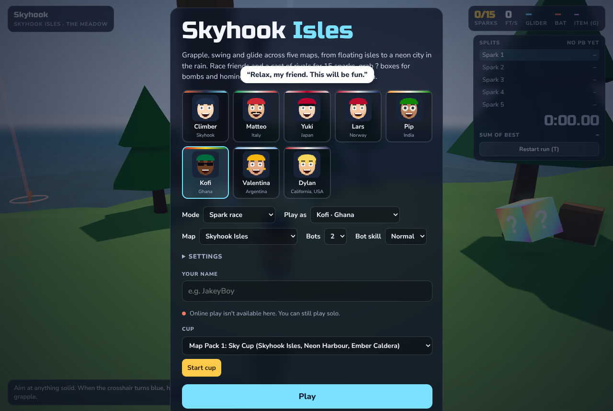
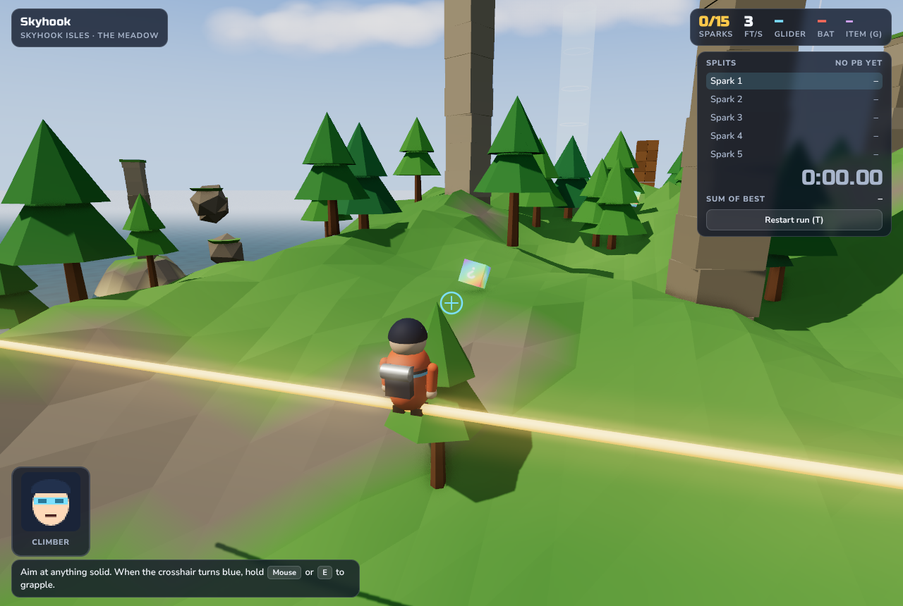

---

## 2026-11-15: Sky Speedway, a race map built for speed

- **New map, Sky Speedway** (`maps/speedway.js`):
  - A 356 m ribbon of track, about 14 m wide, winding over the sea and dropping from 62 m at the start to 8 m at the finish, with gentle rollers, so gravity keeps feeding you speed.
  - Red-and-white kerbs and a dashed centre line, plus cyan and magenta light strips streaming along both edges.
  - Neon arches every 30 m to swing through without slowing.
  - Three 12 m gaps with glowing rings overhead to swing across, and an updraft before the middle gap for a high line.
  - A tailwind horn at the start (a `gust` trap blowing down the course).
- **Sparks in course order**, like checkpoints. Maps can now provide `sparkSpots()` to place sparks in a set order instead of shuffled.
- **Speed strips** (new map feature, `api.boosts`): glowing chevrons that launch you to 34 m/s along the track. For 1.4 s afterwards, ground grip drops from 14 to 1.2, so you keep the speed instead of snapping back to running speed. On the downhill, the test measured 33 m/s at launch and 43 m/s half a second later. Bots get launched too. Tuning is in `tuning.js` (`boost`).
- **Feeling of speed everywhere:** the camera's field of view widens smoothly from 65° to 80° between 14 and 44 m/s (`tuning.js` → `camera`).
- The terrain grid is finer here (1.5 m cells) so the narrow, winding edges don't stair-step.
- Tests: the speedway loads, has 15 ordered sparks and anchors, walking is smooth (narrow maps walk along the track), and the strips launch you with the launch carrying. Two Sumo tests were isolated from nearby bots so they're order-independent. The bot benchmark is still 129.

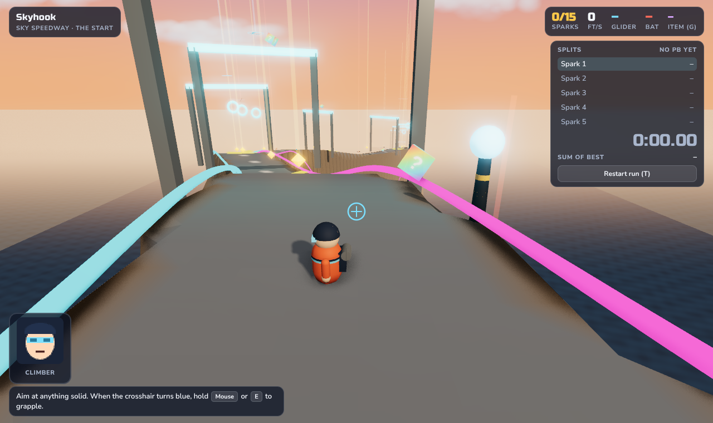
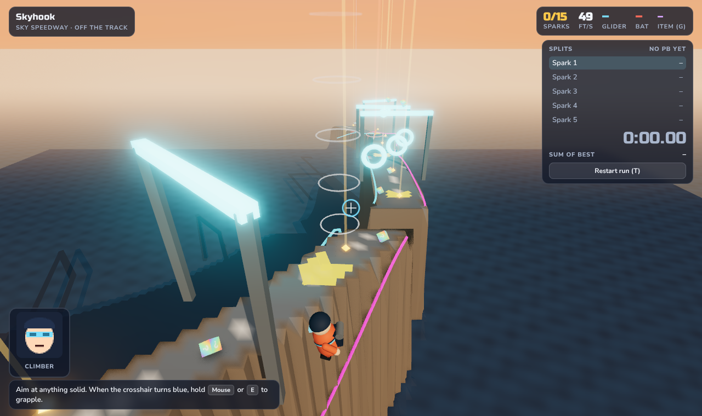

---

## 2026-11-15: Taps on the left half hook; joystick toggle; all tuning in one file

- **Bug (owner):** in the Swing scheme you couldn't hook anything on the left half of the screen, because any touch there started the joystick. Now a finger on the left only becomes the joystick once it drags more than 12 px. A quick tap there fires a hook like anywhere else. **Settings → Controls → Joystick** turns the joystick off entirely, making the whole screen for tapping and looking (you then move by swinging and jumping).
- **Data pass:** every gameplay number now lives in `skyhook-isles/js/tuning.js`, in metres and seconds with comments: gravity; player ride height, speeds, grip, air and rope steering, jumps, rope-jump boost, speed cap; hook range, flight and reel speeds; glider; bat, shove and blast knockback, lift and stun; sniper; cruise missile timing; race and sumo round rules and points; death cam; slow motion; and the four bot skill levels. The engine reads it, and the values are unchanged (the benchmark is exactly 129 again). Together with `maps/*.js` (layouts) and `js/bot-params.js` (trained bot technique), this is the tuning a port to another engine (e.g. Godot) can reuse as-is.
- Tests: a left-half tap doesn't start the joystick, a drag does, and with the joystick off a drag doesn't. Two order-dependent map tests were made robust (Sumo waits for sparks to hide, and the stalemate test isolates the two bots).

---

## 2026-11-14: Two-rope swinging on touch, medals, live standings, cruise missile, big blasts

- **Swing scheme for touch** (now the default on touch, with a one-time switch for existing settings):
  - Tap anywhere to fire a hook there. A second tap adds a second rope, and a third replaces the older one. A hooked player always takes the main rope.
  - Swipe down to reel both ropes in, swipe up to let go (with a little hop), swipe sideways to turn.
  - The camera stays behind you even while swinging.
  - Both ropes share the same rope physics and drawing (`ropeConstraint`, `stepHook`), and anything attached counts for the hover controller, jumping and ground punches. Friends see the main rope only.
- **Medals** (gold, silver, bronze sprites with the place number) float above the top three, including you, whenever anyone has scored. Ties share a medal.
- **Live standings:** hold Tab, or tap Board on touch, for a mid-game table: place (with medal), player, sparks or KOs, K/D. It only re-renders when something changes.
- **Mega power-up: the cruise missile.** Every 2.5 min of play (the first at 1 min), a crate drops on a pillar or rock: a 300 m red beam, spinning warning lamps, a red light, a two-tone siren, the announcer and a toast. Whoever runs the bots decides when and where, and it's a numbered presence event, so everyone sees the same crate. Grabbing it is shared too.
- **Firing the missile:** it locks onto whoever is nearest the crosshair (within 30°, up to 220 m), or flies straight. It homes at 44 m/s with a smoke trail, and detonates on the target, a wall or the ground in a 14 m blast at 2.2× power. The target gets a "MISSILE LOCK!" warning. Firing kicks you back.
- **Bigger explosions:** 16 additive fire sprites billow into 10 smoke puffs, with 18 embers, a shockwave ring on the ground and a 50 m flash of light. Knockback is up from 26 to 38 sideways and from 10 to 15 up, and anyone caught goes into a 1.6 s ragdoll tumble with no control (arms flailing, body spinning). Bots get the same launch.
- Tests: two ropes, reel and release; Tab standings; the missile spawning, being grabbed and firing; the explosion ragdoll and effect; and Sumo medals. The bot benchmark is still 129.

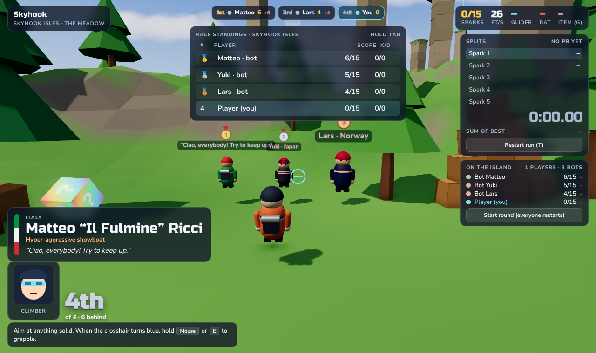
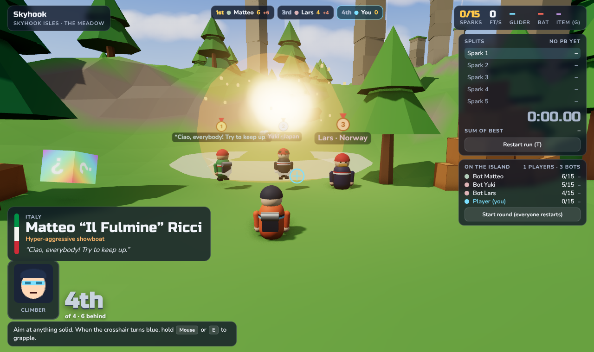

---

## 2026-11-14: Bot skill levels, sniper KO, mobile pause, city cranes

- **Bot skill** (start screen, next to Bots): Easy, Normal, Hard, Brutal. Each level scales the bots' running speed (0.78× / 1× / 1.1× / 1.22×), time between swings (1.9× / 1× / 0.7× / 0.5×), dodge chance (0.3× to 1.8×, capped at 85%) and knockback (0.8× to 1.25×). Easy bots also dither, pausing for 1–2 s every few seconds 40% of the time, so a new player gets a chance. Normal is the benchmarked default (still 129). In multiplayer the setting of whoever runs the bots applies.
- **The spin sniper kills on hit.** A hit is an instant knock-out at the spot (a "SNIPED" death cam, lying where you were hit), credited to the shooter as a KO. On bots, it's a KO for the shooter (the bot respawns). The shield still blocks it. The hit event carries `kill: 1`, and the splash event carries `how: "snipe"`, so the shooter sees "Sniped X!" instead of "Dunked".
- **Mobile:** a pause button (❚❚) next to Chat and Mic. On touch, the face HUD moves to the bottom middle of the screen, with the position badge beside it, clear of the joystick and buttons.
- **Neon Harbour cranes:** two tower cranes at the edges of Lantern Plaza and three on the tallest rooftops. Each has a lattice mast, a slewing cab, a 34 m jib you can hook or walk along, a counter-jib with a concrete counterweight, a red aircraft lamp, and a hook block on a cable to swing from (bots use the hook blocks as anchors too). They glow slightly so they read against the night sky.
- Tests: four skill levels in order, sniper KO on you and on a bot, touch pause and face position, and the Neon hook blocks. A flaky item-box check was hardened (it resets the box cooldown and allows 30 s).

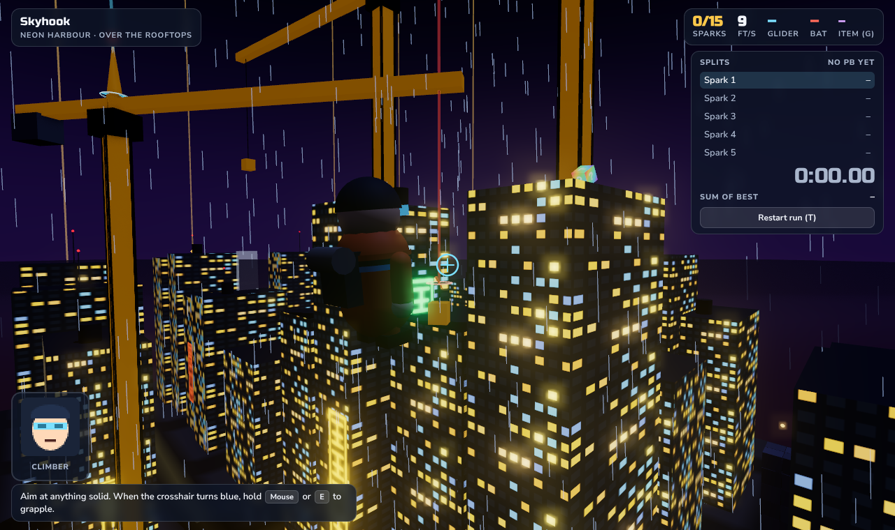

---

## 2026-11-14: Slow-motion finish, click to continue

- When a match ends (the final spark is grabbed, the clock runs out, or someone reaches the KO target), time ramps down to 20% over about 0.3 s and stays there for 3 s of real time. There's a white flash, a low boom, a camera shake, and the music dips. Then the leaderboard appears. Physics, timers and the camera all run on the scaled time; the countdown uses real time.
- The leaderboard shows a pulsing "Click anywhere to continue" ("Tap" on touch). Clicking anywhere (except the initials box), Space or Enter moves on to the next round, or the cup results after the last one. Clicks in the first 0.8 s are ignored so a stray swing doesn't skip it.
- Tests: race end enters slow motion (time scale under 0.5) with the leaderboard still hidden. The leaderboard then appears, and a click in the corner loads the next cup map.

---

## 2026-11-14: Speed units

- **Settings → Display → Speed units:** Imperial (ft/s, the default) or Metric (m/s). The physics still runs in metres; only the display converts (× 3.28084). The Speed Demon award uses the same units. Saved per device.

---

## 2026-11-14: Pop-ups only when it involves you

- Owner feedback: no notifications when other players attack each other. Removed the pop-ups and announcer lines for: a bot dodging someone else's swing, friends or bots grabbing a bat, a friend falling in without your help, and a bot finishing its sparks (the final spark alert already covers that).
- Kept, because they involve you or change your race: hits on you, your hits and dunks, comets aimed at you, traps anyone sets off (they're hazards for you), the final spark appearing or being taken, race countdowns, and cup joins.
- Test: a friend's bat pickup and a friend's swing at a bot leave the toast empty.
- New principle added to `docs/DESIGN-PRINCIPLES.md`: pop-ups are for you.

---

## 2026-11-14: Timer no longer jitters

- **Bug (owner):** the timer box changed width as the digits changed. The display font has proportional digits (a 1 is narrower than an 8), and in the compact HUD the box sizes itself to its text.
- **Fix:** each character of the clock is rendered in its own fixed-width slot (digits 0.64 em, `:` and `.` 0.32 em), so the width depends only on how many characters there are. The DOM is only rewritten when the text changes.
- Test: the timer and its box measure the same width for `1:11.11`, `8:08.08` and `0:44.70`, in both Full and Compact HUD.

---

## 2026-11-14: Custom games, sumo arenas, smarter fighting bots, Pull

**Custom game** (principle 7: everything customizable). Pick *Cup → Custom game…* on the start screen.
- Build a list of 1–8 maps in any order (repeats allowed) with Add map and × to remove.
- Rules: mode (spark race, sumo, or mixed, which alternates), race time (2/3/4/6 min), sumo time (1:30/2:30/4:00), KOs to win (3–20), item boxes on/off, bats on/off, final spark on/off. With the final spark off, a race ends at 15 sparks.
- Start cup plays it like a cup: points per map, final standings and awards. The definition travels in the cup's presence (`cupS.cd`), so friends follow it, and followers validate it. Custom games don't post to the cup leaderboards, since every one is different. The draft is saved per device.

**Sumo arenas** (`sumoOnly: true`; they always play as sumo, and the mode picker won't switch them to race):
- **Sumo Ring:** a 13 m wide stone donut over the sea, with a hole in the middle to fall into.
- **Plank Cross:** four 7 m planks meeting at a small hub.
- Red-and-white warning stripes mark every edge. Eight grapple posts stand in the sea and six rocks float overhead, so a skilled player can swing back from a knock-off. Each arena has a storm-horn trap.
- No buildings on either (`destructibles.count: 0` now really means zero instead of falling back to 4).

**Smarter fighting bots:**
- **Stalemates end.** After 7–11 s of fighting the same opponent without a KO, a bot either leaves them alone for 9 s and picks someone else, or (if it's a dodger) goes to bait at the edge.
- **Edge bait:** the bot waits a couple of metres from the edge facing in. When an opponent rushes at it (closing at over 3.5 m/s), it sidesteps and swings as they run past. It gives up after 7 s.
- **Push toward the edge:** within 9 m, bots circle to the land side of their target before shoving, so the shove sends them toward the nearest drop. The nearest edge is found by marching out in 12 directions, cached per metre.
- The race benchmark is unchanged at 129 sparks.

**Pull** (C on desktop, a new Pull button on touch). While hooked onto something loose (crate, car, the idol) or someone (friend or bot), it drags them toward you at up to 13–20 m/s, faster for lighter things, without pulling you. Then bat or throw them. A friend holding Pull on you drags you to them, and anyone pulled off an edge counts as their KO. On a fixed anchor, it does nothing different (use Shift to reel yourself in). Presence: a 7th field on `h`.

**Players panel** shows KOs in sumo.

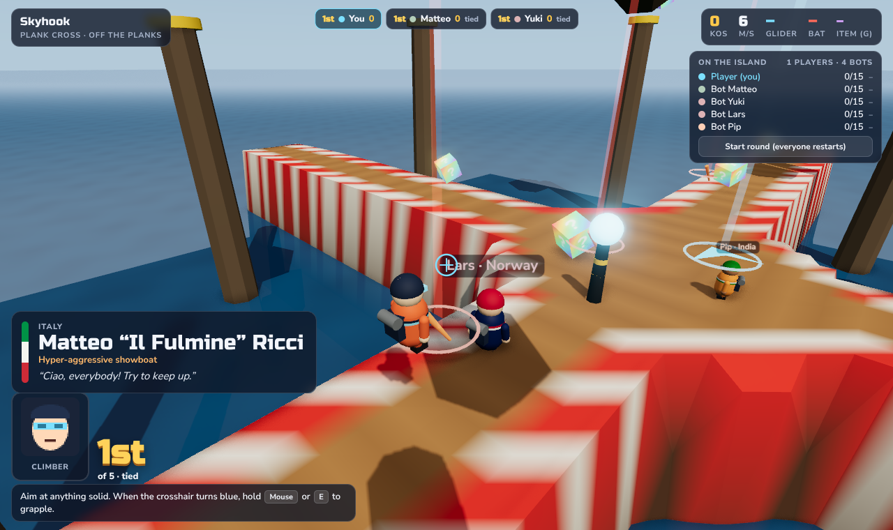
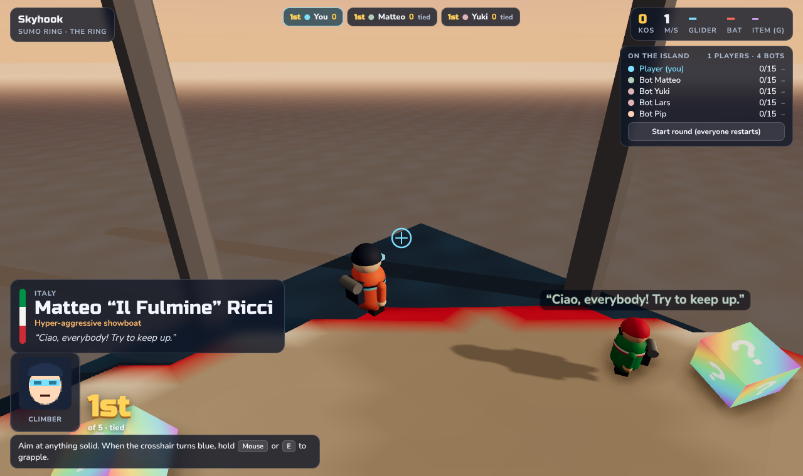

---

## 2026-11-14: No more going through the mountain

- **Bug (owner):** at high speed you could pass through the terrain. At 45 m/s sideways plus a 90 m/s dive, a body moves more than its own width per 1/60 s step, and the test measured the body's centre up to 0.8 m *below* the surface before the fix.
- **Fix (player):** before each step, any velocity that would end inside the terrain heightfield is clipped against the slope normal. Above 15 m/s, a ray along the motion does the same for static bodies (pillars, rocks, buildings). After the step, anything that still ended up under the surface is lifted back on top. Worst case is now 0.45 m above the surface on every map.
- **Bots** don't get it: their trained swing settings were tuned without it, and the benchmark fell from 129 to 115 with the full fix on bots (124 with only the lift-out). It's back to 129 with player-only.
- **Test:** each map slams the player into slopes from 8 directions at full speed and checks the centre stays above the surface. (Neon's centre is flat, so the check is trivial there.)

---

## 2026-11-14: The French announcer is back

- The owner liked a French woman's announcer voice from earlier. The code never chose one on purpose: the announcer asked for the artifact TTS "rounded" voice and otherwise fell back to whatever the browser offered, so it was most likely a French device voice reading the English lines.
- It's now a deliberate setting: **Settings → Audio → Announcer voice: French (her)** (default) or Classic. It picks a French female voice from the device (Amélie, Audrey, Aurélie, Marie, Virginie, Julie, Céline, Chantal and so on, or any French voice) and reads the English lines with that accent. If the device has no French voice, it falls back to the classic voice. Bot voices are unchanged (still text only).
- Recorded clips in `voice/` still take priority over either synthetic voice.

---

## 2026-11-14: Character models

- Each cast member is now dressed by `dressBody()` instead of being the same body recolored. They get their own skin tone on the head and hands, eyes, a three-stripe chest band in their flag colors, and legs with boots that swing while walking, kick while falling and trail while gliding.
- Signature features: Matteo's mustache, Yuki's bangs and ponytail, Lars's beard, Pip's big eyes, Kofi's shades, Valentina's gold hoops and ponytail, and Dylan's shaggy surfer hair. The Climber keeps the goggles.
- Friends start as the Climber and get re-dressed when their character arrives in presence. Bots are dressed when their avatar is created. Geometry and materials are shared through a cache, so the cost per character is small.

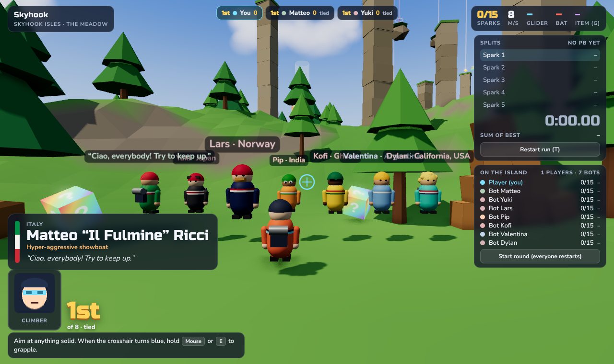

---

## 2026-11-14: Light shafts and softer clouds

- **Light shafts** (High graphics, day maps). A screen-space pass after bloom streaks bright pixels near the sun outward along 40 jittered samples, so anything in front of the sun (pillars, rocks, the player) breaks the light into rays. It fades in when the sun is on screen and out when it's behind you. The jitter turns the sample dots into smooth streaks.
- **Softer clouds:** three cloud textures, each built from 60 low-alpha puffs that are brighter on top and slightly blue-grey underneath, instead of 14 hard white blobs.
- The High-graphics test now checks that bloom, AO and light shafts all load.
- Still open in this roadmap item: better character models.

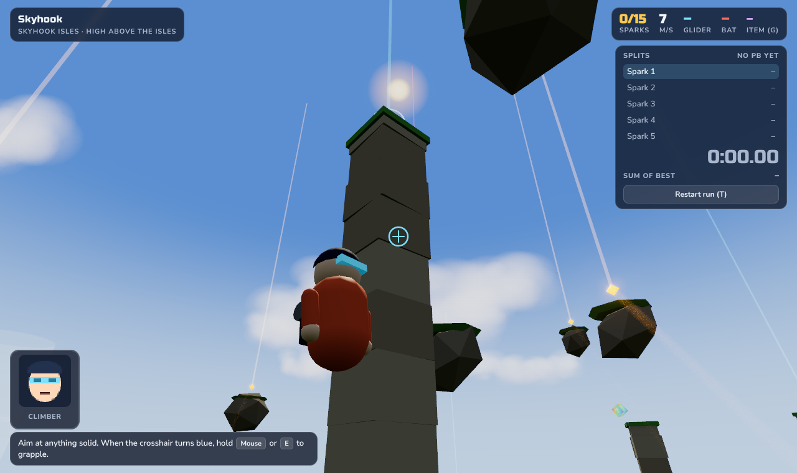

---

## 2026-11-14: Sumo mode, and a trap on every map

**Sumo** (principle 3: a mode for fighters and trolls). Pick *Mode → Sumo: knock-offs* on the start screen. Pressing Play starts a round, and Start round syncs the mode to friends (`md` on the race event).
- Sparks and splits are out of play. The HUD shows **KOs** and the timer counts down a 2:30 round. The first to **10 KOs** or the most at the bell wins (ties go to fewer falls). Results show KOs, falls and hits.
- You respawn at a random spot on land with a death cam of at most 3 s. Bats respawn every 8 s. Item boxes favor bombs and spin snipers (no spark magnet).
- **Bots fight everyone, each other included.** Only true cowards (fear > 0.8) run, and only from someone armed. Bot-on-bot knockoffs count as KOs for the bot.
- KOs and stats reset at the start of each round or race.

**Traps on the other four maps**, using three new engine kinds and a shared `trapTrigger()` post (striped pole with a glowing button):
- **Skyhook Isles: storm horn** (`gust`) near the meadow. A 6 s gale blows across the island toward the sea, strong enough to push people standing on the ground (60 m/s² against ground grip) and much stronger in the air. Gliders ride it. Wind streaks show the direction.
- **Neon Harbour: transformer** (`zap`) in Lantern Plaza. For 6 s the rooftops are live: anyone standing more than 5 m above the street gets zapped into the air every 0.9 s.
- **Frozen Spires: avalanche bell** (`boulder`) on the ice crown. A giant snowball rolls down toward base camp.
- **Jungle Ruins: temple lever** (`boulder`). A stone ball rolls down the temple steps toward the camp.
- Boulders flatten anyone they touch: 30 m/s knockback, a tumble, and dunk credit to whoever set them off. Each game rolls its own copy from the same start.
- Tests: every map must have a trap, triggering must work, and boulders must actually roll (glacier 24 m, jungle 60 m in 2.5 s). Bot benchmark unchanged at 129 sparks with all of this in.

---

## 2026-11-14: Spin sniper

- A new item from ? boxes, available to anyone (no rank weighting). It **only fires after you turn a full 360°**: the HUD shows `SPIN 0–100%`, and the coils on the barrel glow brighter as you turn. A full turn charges it for 3.2 s (`FIRE 3`), with a rising tone and a pulsing cyan glow. Spin while swinging or gliding, then fire: the requirement is the trick. Spinning the other way halves your progress, and holding still lets it fade.
- **The shot:** hitscan from the crosshair, up to 160 m, with a generous aim cone that widens slightly with distance. Walls and terrain stop it. A hit is a bat hit ×1.6 (the biggest knockback in the game). You get a recoil kick, a cyan tracer, and the announcer shouts "Trickshot!" if you're airborne or "Sniped!" if not. A miss sets off a small blast where the bullet lands.
- **Trickshot Artist** award; `snipes` stat in presence.

---

## 2026-11-14: Maps are toys: traps, throwing, smashing walls

Principle 4 ("every map has something to trigger") and principle 1 ("if they want to break through a wall, let them").

- **Trap system.** A map's `build()` pushes trap definitions into `api.traps`, and the engine runs them. Setting one off is a numbered presence event (`trp`), so every game runs the trap at the same moment and applies it to its own player (the bot controller handles bots). Activators get credit: anyone who falls in while trapped counts as a dunk for whoever set it off.
- **Scrapyard Canyon: crane magnets.** Yellow consoles with a big red button and warning lamp sit on both rims of the gorge. Hit the button or hook it, and after a 0.8 s flashing windup all 14 magnets turn red for 8 s. Anyone within 10 m is pulled in and pinned underneath. Mash Jump 4 times to break free (bots wriggle loose after 3–5 s, depending on how scared they are). Then it's a long drop into the river. 18 s cooldown.
- **Ember Caldera: the idol.** A stone idol with a gold mask and glowing eyes stands on a torch-lit altar on the cone. Hook it and drag it, throw it, or bat it into the crater, and the volcano erupts: a 22 m blast at the top, then 12 s of lava bombs arcing out up to 80 m and exploding where they land (they knock people around and blow holes in buildings). The idol goes back on its altar, with a 40 s cooldown. It also respawns if it lands in the lava.
- **Throwing.** Hook anything loose (crates, cars, the idol), then press Hit: it flies where you're looking (20–40 m/s, faster for light things). A thrown or batted prop that hits a player knocks them like a bat, scaled by its speed (`m` on the hit event).
- **Breakable walls.** Bat swings (2.8 m) and shoves (1.7 m) knock blocks out of destructible buildings, and hitting one at more than 21 m/s smashes straight through at 90% speed.
- **New awards:** Trap Master, Yeet Lord, Wrecking Ball. New stats `traps`, `throws` and `smashes` are added to presence.

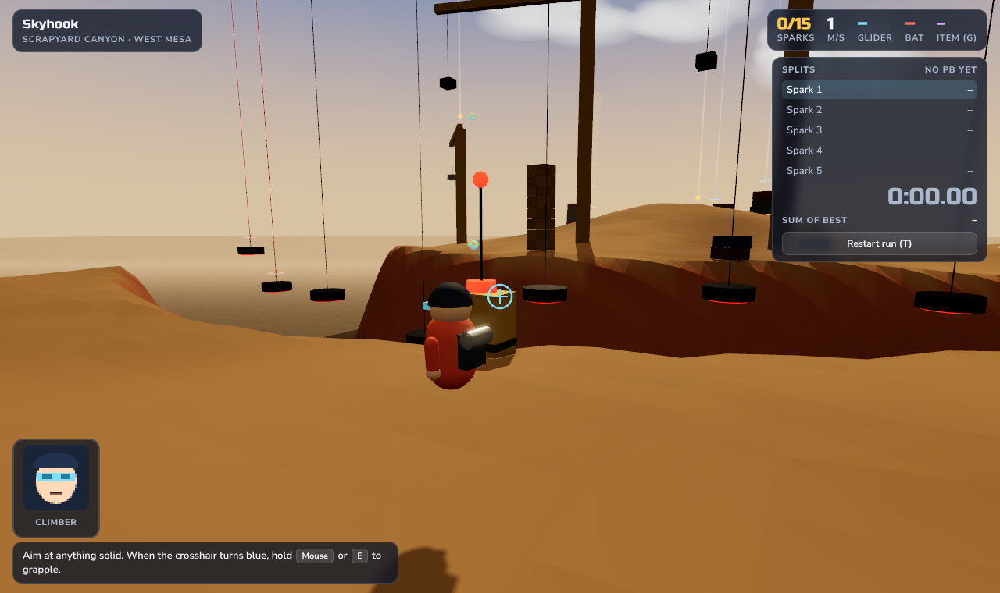
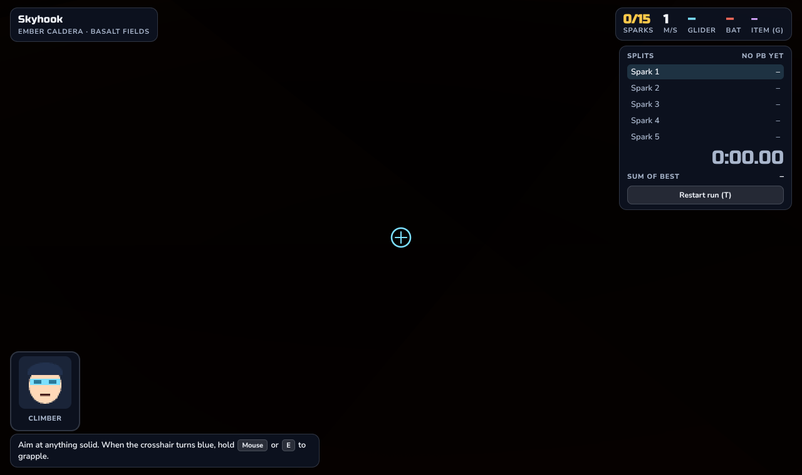

---

## 2026-11-14: The final spark

- When anyone (you, a friend or a bot) collects all 15 sparks, a **final spark** appears about 25–55 m from them (aiming for 38 m on a pillar, rock or spark spot). That's a head start for whoever finished first, but still a race.
- **The fuss:** a big spinning gold core in a wireframe shell, a tall light pillar, four colored searchlights sweeping the sky, a pulsing light, a screen flash, a fanfare, and the announcer (`final` and `finalgot` lines added to `tools/voice/LINES.md`). The music jumps to its hardest section with a climbing alarm arpeggio until someone grabs it.
- **Scoring:** the final spark is worth +5. Standings, the ribbon and the position badge use that score, and results mark the grabber with ★. A race now ends when the final spark is taken (or on the 4-minute clock), not at 15 sparks.
- **Bots** go for it once they have all 15, or if it spawns within 35 m of them.
- **Multiplayer:** spawn and grab are numbered presence events (`fin`, `fg`), applied once, like hits.
- **Fix:** at High graphics the ambient occlusion pass drew cloud sprites and see-through glows as solid dark rectangles in the sky. It now skips sprites and depth-less transparent meshes. This was live from the AO publish until now.

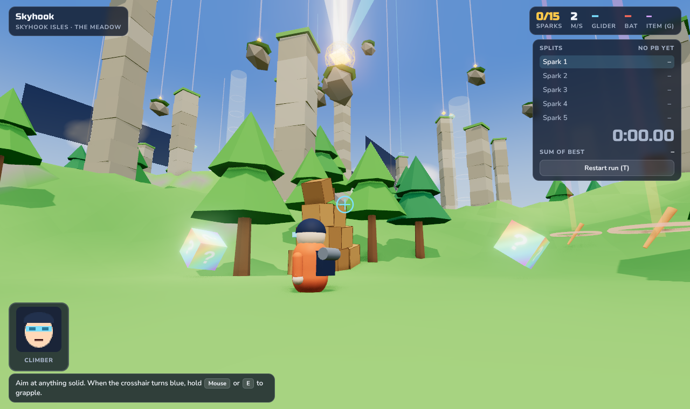

---

## 2026-11-14: Death cam, ground punch, live standings, touch overhaul

The owner's new batch of ideas, along with the design principles behind them, is in `docs/DESIGN-PRINCIPLES.md` and in the roadmap. This entry covers the first part.

- **Splash and death cam.** Falling in throws up droplets, two spreading rings and a white column (orange on the lava map). You sink while the camera slowly orbits the splash for 10 s so you can admire the death. Space, R, Jump, or tapping the card respawns right away. The length (10/5/3 s or off) is a setting. Friends and bots get splashes too: anyone crossing the surface makes one.
- **Ground punch.** Shove or swing at the ground (or the water) within about 3 m while falling, and you bounce back up. The faster you were falling, the bigger the bounce, and it refunds your air jump. With the bat, the bounce is higher and the slam knocks back anyone standing nearby. Timing it saves a fall: that's skill-ceiling stuff.
- **A scary bat.** Knockback went from 24 to 40, launch from 12 to 16 m/s, 1.3 s with no ground control, and the victim tumbles. Props fly almost twice as far.
- **Live standings.** A strip at the top shows the leader, the player just ahead of you, and you, with spark gaps. A big Mario Kart style position badge (1st/2nd/3rd colors) sits by the face and says how far ahead or behind you are.
- **Stats and awards.** Each race tracks deaths, dunks, hits, home runs, ground punches, items, air time and top speed, shared with friends in presence. Results show K/D. Cups add everything up and hand out awards at the end: Spark Hoarder, Menace, Home Run Derby, Hands On, Most Dramatic Exits, Pogo Stick, Frequent Flyer, Speed Demon, Item Gremlin, Bone Dry.
- **Input-aware UI.** The game switches between the touch and keyboard/mouse layouts based on what you last used: touch buttons, help text, and keyboard hints like "(T)" and "(G)" are hidden on touch.
- **Bug fix:** the page body had the class `touch`, which also matched the overlay rule `.touch{pointer-events:none}`, so taps on some panels could fall through on touch devices. The body class is now `in-touch`.
- **Settings panel** with Controls, Display and Audio groups:
  - **Touch scheme:** Classic, or Simple, where you tap where you want to go: the hook fires there, reels you in automatically, and the camera swings behind you as you move. Tap again or press Jump to let go.
  - **Aim assist** (off/low/high): if the crosshair misses, it searches widening rings (4.5° or 9°) for something to hook and shows a ring marker on it. Low is the default on touch.
  - **Look sensitivity** slider. Touch look is 1.5× faster by default.
  - **Gyro aim:** turning the tablet turns the camera, mapped for the screen orientation, with an invert option. iOS asks for motion permission.
  - **HUD: Full or Compact.** Compact is the default on touch: no title chip, splits collapse to the timer, the player list folds into the standings strip, and the face, stats and intro card are smaller.
- **Bots:** per-character training for Valentina (7.00 → 8.67) and Dylan (3.67 → 4.67). On the 60 s benchmark the total went from 121 to 129 sparks (Valentina 13 → 22, Dylan 15 → 14 with no falls).

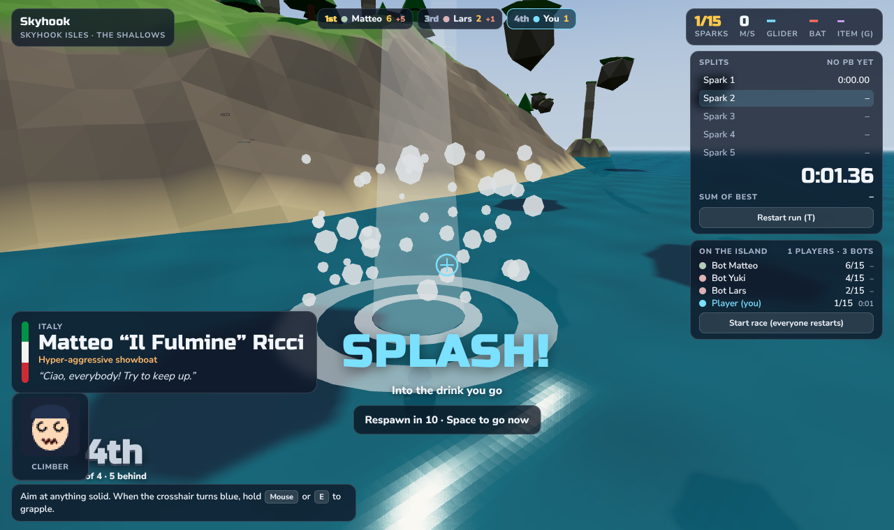
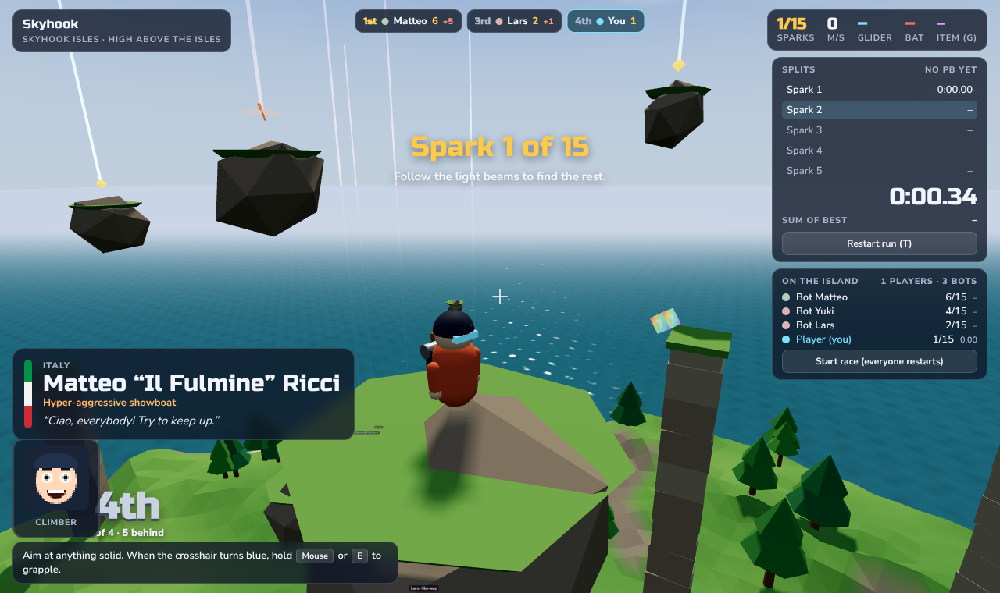
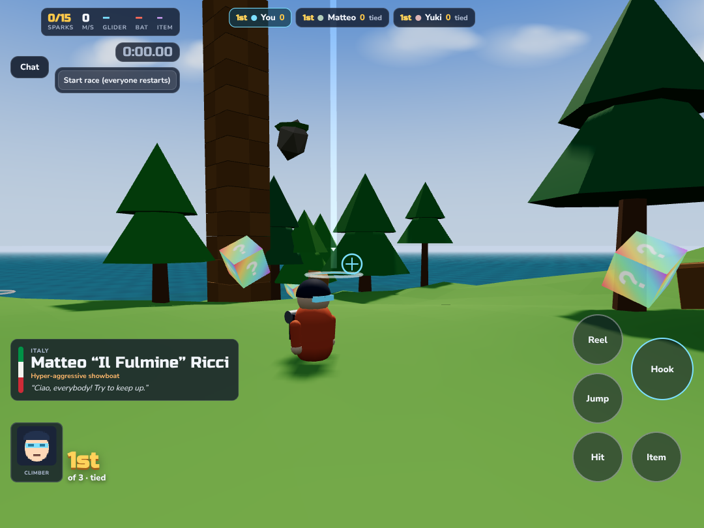
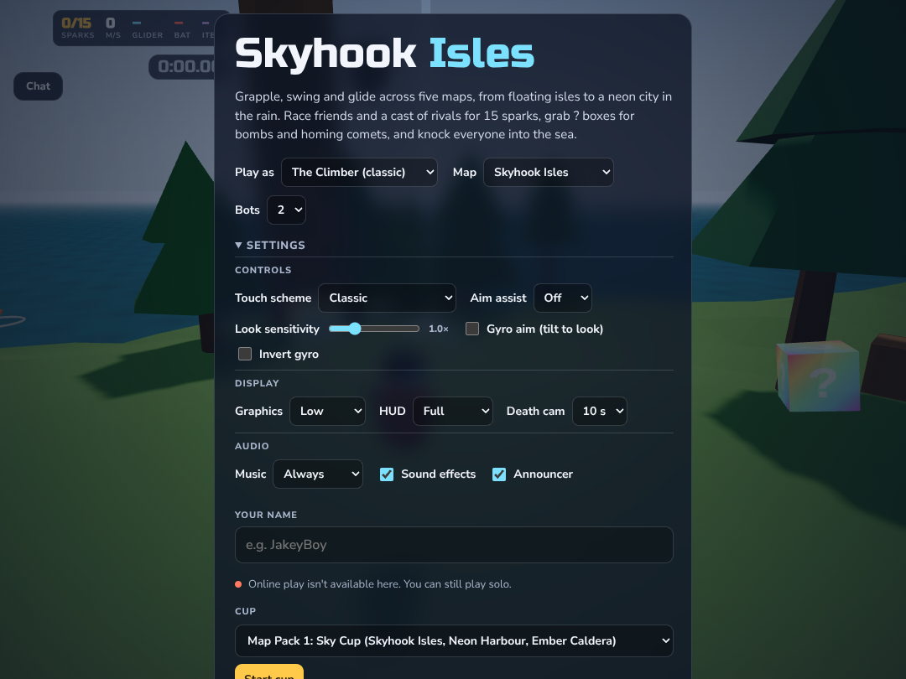

---

## 2026-11-14 (overnight): Ambient occlusion at High graphics

- **GTAO** (three.js ground-truth ambient occlusion) now runs at High graphics only, between the render and bloom passes. It darkens creases and contact points: under box stacks, at tree trunks, and where rocks meet the grass. That makes objects look grounded instead of floating.
- It loads with a dynamic import, so if the add-on fails to load, the game falls back to bloom only. Medium and Low (the iPad default is Medium) skip it, because it's the most expensive pass.
- Tuning: radius 1.6, 12 samples, blend 0.85. That's subtle on purpose, so it doesn't muddy the low-poly look.
- The test `bloom and ambient occlusion load at High graphics` checks it.

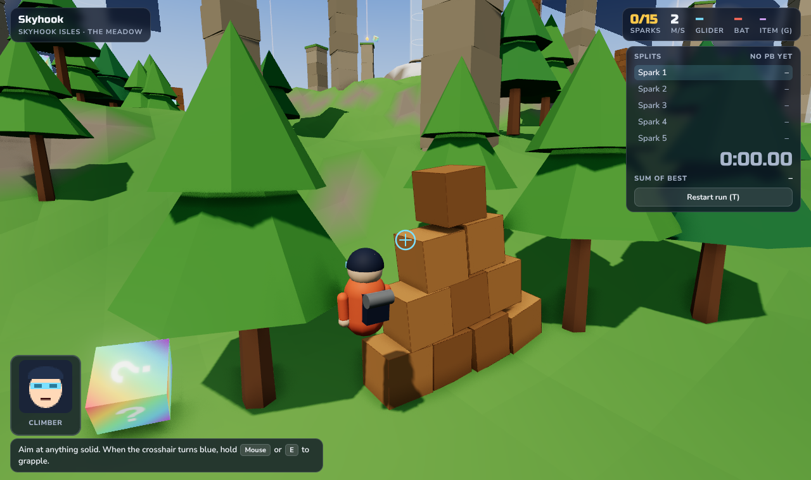

---

## 2026-11-14 (overnight): Synced multiplayer cups

- **Host:** whoever presses Start cup hosts it, and their presence carries the cup (`cupS`: id, pack, race number, points table, done).
- **Friends follow automatically,** even from another map: they adopt the cup, get a "Joining X's cup" toast, and switch to the cup's current map.
- **Races:** the host's Play starts each race for everyone, using the existing shared race countdown.
- **Points:** the host's points table is authoritative. Followers see the same totals and the final standings when the host finishes.

Tested with the scripted friend (a friend hosting race 2 of Map Pack 1 pulls you onto Neon Harbour with their points). Real two-device play is still untested.

## 2026-11-14 (overnight): Second training run, with the bots at their best

The first fully reproducible training run: 8 generations × 8 candidates, 40 s episodes, Yuki, Lars and Dylan from 3 starts each, run on a copy of the repo while other work continued. Fitness went from 2.83 to 4.44 (+57%). The winner fires from a little farther, reels slower, keeps a shorter rope, releases earlier, and boosts harder up and forward on release.

Benchmark across all 7 characters (45 s × 3 starts each):

| | Sparks | Falls |
| --- | --- | --- |
| Start of the night | about 7 | — |
| After the bug fixes | 61 | 15 |
| First training | 68 | 8 |
| Plus personalities and gliding | 74 | 8 |
| **Second training** | **92** | **9** |

Dylan's "loose ropes" personality clashed with the new technique (5 sparks). I measured variants and switched him to "surfs long swings between far anchors", which keeps him close to his untuned best.

## 2026-11-14 (overnight): Sixth map, Jungle Ruins

- **The island:** lush, cut by a river, with a stepped five-tier stone temple in the middle. The temple has a gold shrine on top and spark spots at every tier corner.
- **Grapple targets:**
  - 14 giant canopy trees, 20–34 m tall, whose leafy crowns are standing platforms
  - 12 ruined columns, some toppled
  - 50 small jungle trees
- **Safety and lift:** moss stones float over the river and around the coast to catch falls, and mist geysers act as updrafts.
- **Atmosphere:** yellow-green fireflies, soft haze, and clouds.
- **Cup:** Map Pack 2 (Frontier Cup) is now Glacier Spires, Scrapyard Canyon and Jungle Ruins.

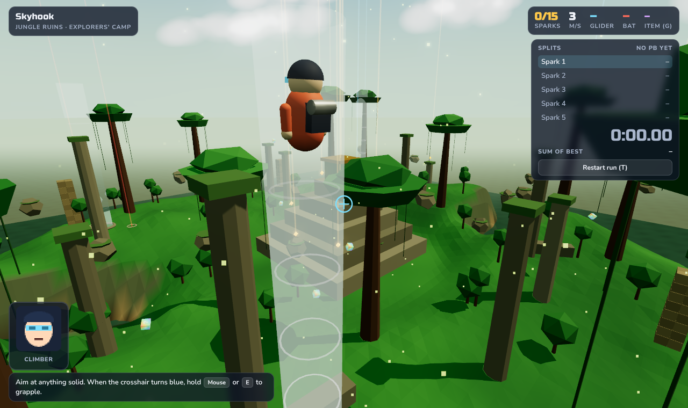

## 2026-11-14 (overnight): Bots glide

Bots now pick up glider pickups they touch. When one is falling with no rope out, its target spark is more than 15 m away and it's above the target, it opens the wing: the same lift as the player, a 3 m/s sink, and a push toward the target. Friends see the wing and the arm pose too.

Benchmark with personalities and gliding: **74 sparks** (7 characters × 3 starts × 45 s), the best yet, with 8 falls.

## 2026-11-14 (overnight): iPad layout pass

I checked the game in an iPad Pro 11" landscape touch viewport.
- **Start screen:** Play was below the fold. It's now right after the options, and the controls list folds into a "Controls" section. The pitch now describes all five maps.
- **Chat buttons** overlapped the map name. They now sit below it, with the chat log moved down to match.
- **Draw calls** are only 66–160 per frame on every map (frustum culling does the work), so batching geometry isn't needed for iPad performance.

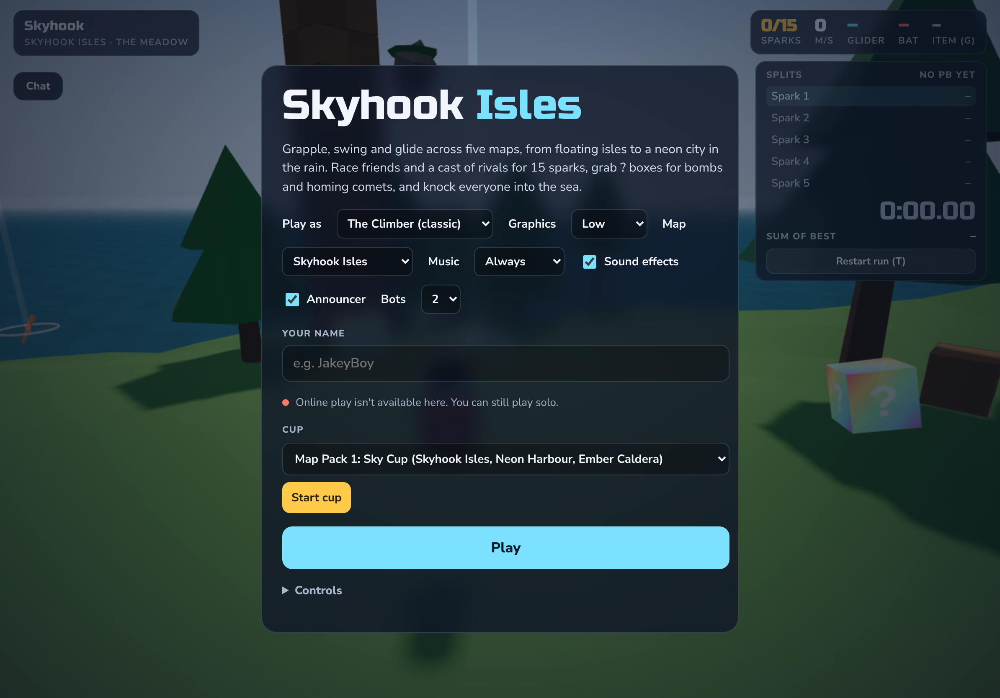 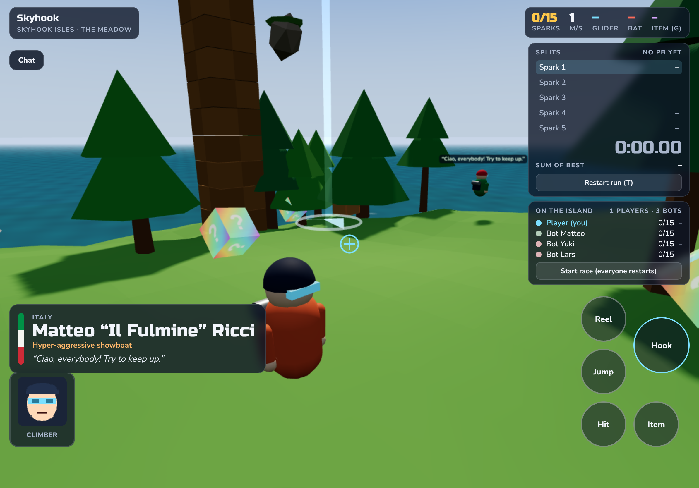

## 2026-11-14 (overnight): Arms, sun and clouds

- **Arms:** every character has arms in their suit color.
  - They swing with the walk cycle.
  - The right hand reaches up the rope while grappling.
  - Both hold the glider bar.
  - They flail during a fast fall.

  Friends and bots use the same poses, driven by their shared velocity and rope state.
- **Sun disc:** a glowing disc (a moon on night maps) in the sun's direction. Bloom makes it glow.
- **Clouds:** soft drifting clouds on day maps, tinted ashy on the volcano.

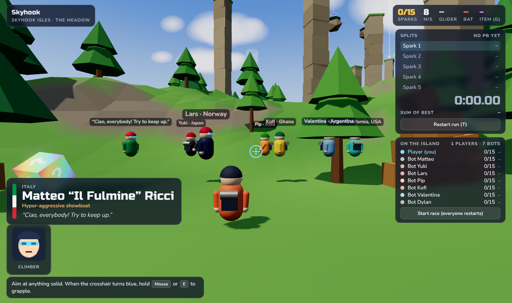

## 2026-11-14 (overnight): Exactly reproducible training, and personality in how bots race

**Reproducibility, fixed for real.** The same parameters were scoring 2.11 on one run and 3.61 on another. Four leaks, each found by tracing:
1. **The real-time loop ran between reload and evaluation.** How much simulation happened depended on CPU speed. There's now a headless start: only `tick()` advances the simulation, and entrances are skipped.
2. **Pickup and item-box timers counted down in wall-clock time.** They now advance only with simulation steps, and item boxes reset on restart.
3. **Stale bot state leaked into episodes.** Physics runs before the brain each tick, so the first step used the walking direction left over from setup. Every per-bot field is now reset per episode.
4. **Page reloads timed out under load.** They now retry with longer timeouts.

Result: identical scores run after run, including under heavy CPU load. Training also runs on a copy of the repo, so game work can continue in parallel.

**Newly trained default technique:** training fitness went from 2.56 to 3.61 in one generation. Across all 7 characters, 68 sparks (from 62) and falls halved (8 from 15).

**Personality on top of skill** (per-character overrides in `js/bot-params.js`, each measured against the same character with the overrides off):

| Character | Style | Score without, then with |
| --- | --- | --- |
| Yuki | Barely minds climbing: goes for high sparks, long risky swings | 3.00 → 3.67 |
| Lars | Dislikes climbing: prefers low sparks | 2.83 → 3.50 |
| Dylan | Rides longer, looser ropes | 3.00 → 3.50 |
| Pip | Avoids sparks within 22 m of other players | (behavioral) |

## 2026-11-14 (overnight): Bots use items, in character

- **Pickups:** bots grab ? boxes they touch. Leaders draw shields, magnets, boosts and bombs; bots behind draw bombs, comets and boosts.
- **How they use them** (after a short beat, so it reads as a decision):
  - **Bombs:** thrown at the nearest player. Aggressive characters (Matteo, Valentina, Lars, Kofi) throw from up to 22 m, others only up close.
  - **Comets:** fired at the leader, which can be you. You get a warning.
  - **Shields:** fearful Pip raises hers as soon as anyone is within 14 m. Others wait until someone is close.
  - **Magnets:** used near their target spark.
  - **Boosts:** only on long, dry runs toward their target. Early versions launched bots into the sea.
- **Blast credit:** bot blasts count as last-touch, so bots can score dunks with bombs.

Benchmark: 62 sparks (7 characters × 3 starts × 45 s), about the same as before items.

## 2026-11-14 (overnight): Graphics push

- **Bloom** (three.js `UnrealBloomPass` with an `OutputPass` for tone mapping) makes neon signs, lit windows, lava, sparks, item boxes and lightning glow. It's stronger on night and lava maps. The add-ons load through an import map, and if they can't load, the game renders normally.
- **Animated water:** a procedurally generated tiling normal map (sums of sines), scrolled every frame, with low roughness so the sea ripples and catches the sun.
- **Graphics setting** (start screen): High (pixel ratio up to 1.75, 4096 shadows, full-res bloom, 4× MSAA), Medium (1.25, 2048, half-res bloom), Low (1, 1024, no bloom). The default is High on desktop and Medium on touch devices like the iPad.
- **Tests** run at Low, because the software renderer can't keep up with bloom, plus one check at High that the bloom add-ons load cleanly.

 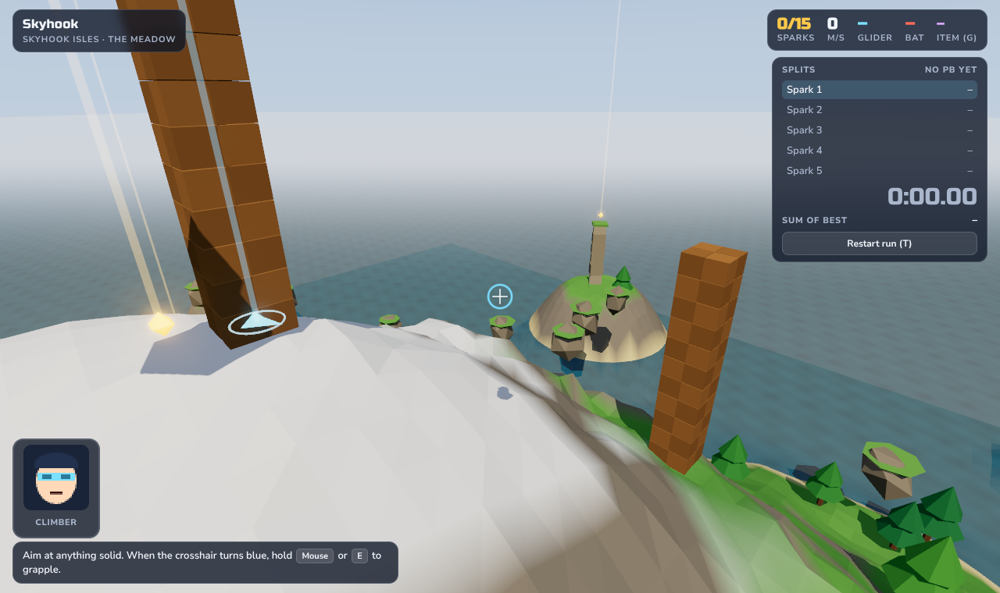

## 2026-11-14 (overnight): Mario Kart items and destructible towers

**Item boxes.** About 16 rainbow ? boxes per map (around spawn, on some pillar tops, scattered on the ground) respawn 8 s after pickup. You hold one item and use it with **G** (or the Item button). Rolls are weighted by race position: leaders mostly get shields and magnets, and the back of the pack gets bombs and comets.

| Item | What it does |
| --- | --- |
| Rocket boost | A burst forward and up |
| Bomb | Thrown forward; 1.8 s fuse; a radius-7 blast that knocks back everyone nearby and breaks towers |
| Homing comet | The blue-shell equivalent. Hunts whoever has the most sparks (player or bot) and explodes on them, 1.6× power |
| Shield bubble | 8 s immune to hits and blasts |
| Spark magnet | 6 s of collecting sparks within 14 m |

**Destructible towers.** Each map has 5–7 block towers (2×2 blocks, 8–13 floors, colors per map).
- An explosion turns blocks within its radius into flying debris.
- Every block left above a hole in its column collapses too.
- Towers rebuild when a race starts.

**Multiplayer.** Explosions are shared through presence (a numbered `boom` event). Each game knocks itself back and breaks its own copy of the towers, and whoever runs the bots knocks the bots. Hits from blasts count as last-touch for sea dunks.

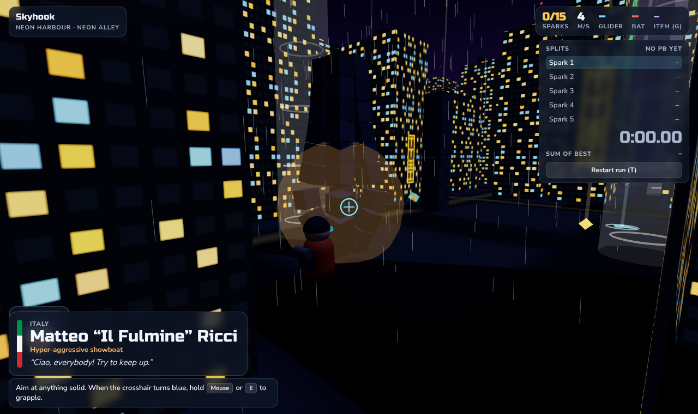

## 2026-11-14 (overnight): Character select and a reacting face

- **Play as:** pick any of the seven cast members, or the original Climber, on the start screen. Your colors and size show for you and your friends, and bots fill in with characters nobody picked.
- **Doom-style portrait:** a 42×42 pixel face in the bottom-left reacts to what's happening:
  - **ow** when you're hit
  - **panic** when you're falling fast
  - **dizzy** after a splash
  - **grin** for sparks, power-ups and dunks
  - **thrill** while swinging, gliding or going fast
  - **idle**, with blinks

  Each character has their own features: Matteo's mustache, Yuki's bangs, Lars's beard, Pip's big eyes, Kofi's shades, Valentina's earrings, Dylan's surfer hair, and the Climber's goggles.

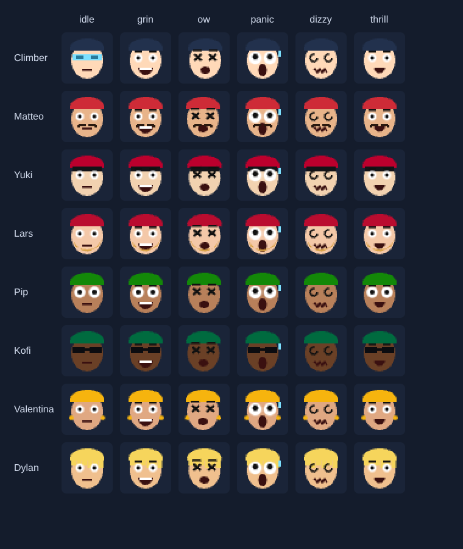

## 2026-11-14 (overnight): Smart bots, four new maps, cups, leaderboards

**Bots race for sparks.** Each bot has its own spark set and a new brain (`botRace` in `js/main.js`):
- It picks the cheapest spark (distance plus climb cost).
- For a spark on a structure, it hooks the structure's near rim, reels in, and pops over the edge.
- For a far spark, it picks stepping anchors and swings between them.
- It brakes in the air to land, catches itself when falling toward the sea, backs off when stuck under a rock, and skips sparks it can't reach for a while.

Personality still decides when they break off to fight or flee.

Bugs found by tracing bots second by second:
- **Rocket loop:** "release when above the anchor" plus an upward boost on every release made bots climb to 180 m.
- **Underside hooking:** aiming under floating rocks got bots reeled into them and flung by the physics.
- **Speed pile-up:** a rope pulling a bot against a wall piled up speed to 1,700 m/s. There's now a hard 45 m/s cap, and bots let go of ropes that aren't pulling them closer.
- **Sleeping bots:** the physics engine put idle bots to sleep, which froze them.

Result: about 1 spark per minute per bot at the start of the night, about 4 per minute now (`npm run bench-bots`).

**Training loop.**
- `npm run train-bots` evolves the 11 swing-technique numbers by simulation and writes `js/bot-params.js`.
- The first version was fooled by noise. Now every evaluation reloads the page for a fresh physics world and seeds the randomness, so the same parameters always score the same.
- Score: sparks minus half the falls, over 3 characters × 3 start points.

**Four new maps** (`maps/*.js`), picked from the start screen:
- **Neon Harbour:** a rainy night city inspired by Hong Kong. Towers with lit windows, neon signs, wet streets, steam-vent updrafts, the harbour around it, rain and lightning with thunder.
- **Ember Caldera:** a volcano in a lava sea. Hexagonal basalt columns, obsidian rocks, ash geysers, rising embers.
- **Glacier Spires:** glowing ice spires, ice floes, slippery ground that keeps your momentum, snow, and northern lights.
- **Scrapyard Canyon:** two mesas split by a gorge. Cranes, stacked wrecks, loose cars to shove, and hanging magnets over the gorge to catch falls.

Each map keeps its own personal bests, and friends on a different map aren't drawn into yours.

 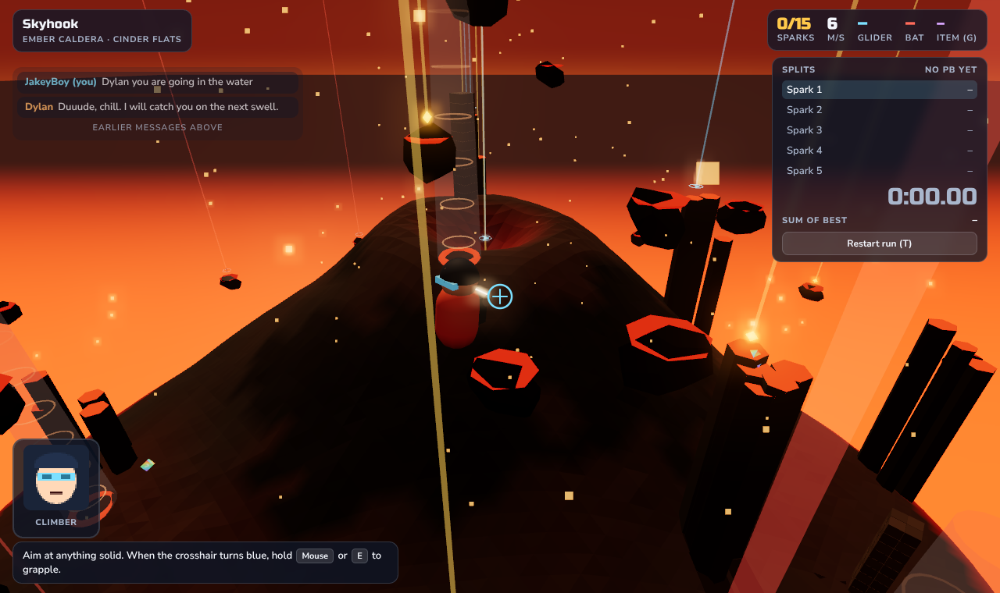
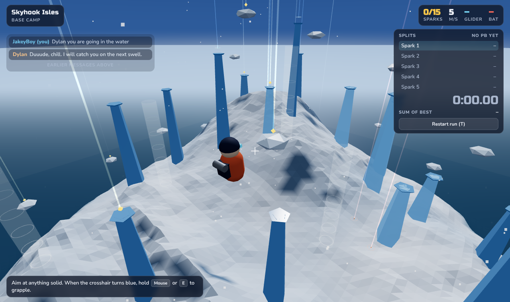 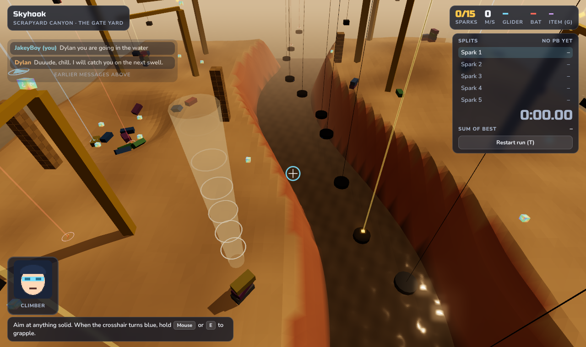

**Cups (Mario Kart style).**
- Pick a map pack and press Start cup. Each race starts automatically with a countdown.
- A race ends when someone collects all 15 sparks, or after 4 minutes.
- Standings rank sparks, then time. Points go 10, 8, 6, 5, 4, 3, 2, 1. Then you go on to the next map.
- After the last map, a final standings screen.
- Map Pack 1 (Sky Cup) is Isles, Neon Harbour and Ember Caldera. Map Pack 2 (Frontier Cup) is Glacier Spires, Scrapyard Canyon and Neon Harbour.
- Cup progress survives the reload between maps.
- Races outside a cup now end with a results screen too.

**Leaderboards.**
- Best full-clear times per map, with 3-letter arcade initials, are stored in the artifact's shared database.
- The board shows on the start screen. Anyone the game is shared with can read it, and Contributors can post.
- Cup point totals post to a cup board.

**Tests.** `npm test` now runs `tools/test-skyhook.js` (26 checks) plus `tools/test-maps.js` (29 checks): every map loads, has 15 sparks and grapple targets, spawns you on dry ground, walks smoothly and spawns moving bots, plus the cup flow end to end.

## 2026-11-14: Chat polish, text-only characters

- **Text only:** characters no longer speak aloud (feedback: the synthetic voices didn't sound good). Their lines appear as speech bubbles and in the chat log. The match announcer stays, with its own toggle.
- **Chat history:** the chat panel keeps the last 60 messages, scrolls, and is saved across reloads.
- **Conversations:** a message without a name goes to whichever character spoke to you in the last 25 s, and each character remembers the last few lines, so back-and-forth chats stay coherent.

## 2026-11-14: Skyhook Isles, map system, chat, outer islets

**Restructure.** The game was one 1,500-line HTML file. It's now split:
- `index.html`: page, styles, HUD
- `js/main.js`: engine: rendering, physics, player, multiplayer, bots, audio
- `js/lib.js`: shared noise and math helpers
- `maps/*.js`: one file per map (terrain height, colors, sky, objects), listed in `maps/index.js`

Maps are picked by URL hash (`#map-isles`) for now. The artifact publishes the extra files alongside the page.

**Expanded Skyhook Isles.**
- The world grew from 240 m to 320 m square.
- Five outer islets, mostly on the far side from spawn, each with a pillar.
- A ring of 18 floating catch-rocks just off the coast, plus stepping rocks out to each islet, so a knock-off or a missed swing can be saved.

**Chat.**
- Enter opens text chat. Hold V (or the Mic button) for voice: the dictation capability turns speech into text.
- When you chat with bots around, the bot you name (or a random one, about 40% of the time) answers in character. The line is written by Claude via the sample capability, spoken in their voice, and shared with friends.

**New character.** Dylan "Swell" Hayes from California: a chill surfer who rides ropes and rarely starts fights. Entrance move: shaka sway.

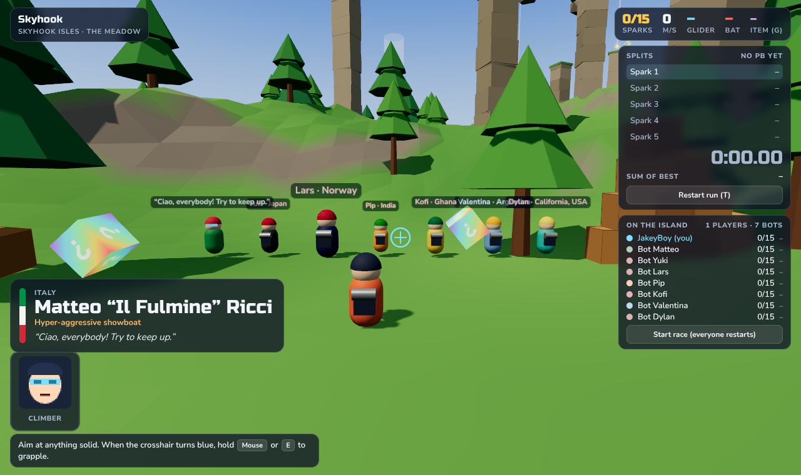

## 2026-11-14: Skyhook Isles, bots become a cast of characters

Six original characters, each with a nationality, colors, entrance card and move, voice, catchphrases and AI traits (aggression, fear, grapple use, dodge, knockback, grudges). They were inspired by the casts of *Sports Champions* and *Rockstar Table Tennis*. Bots run on one player's game and are shared through presence, with handover when that player pauses or leaves.

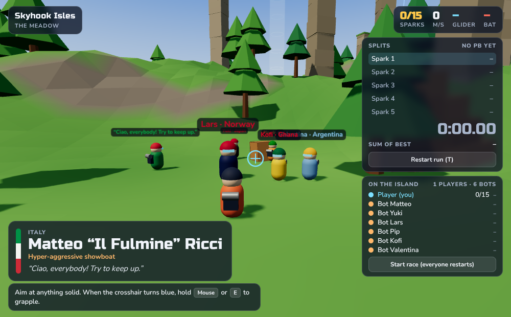

## 2026-11-14: Skyhook Isles, combat, sound, music, announcer, tooling

- **Combat:** shove (F) plus a baseball-bat power-up. Hits are numbered events the target applies to itself. Sea dunks are credited to the last hitter within 8 s.
- **Sound effects:** synthesized live.
- **Music:** an original procedural 132 BPM techno track (acid bass, stabs, breakdowns).
- **Announcer:** Claude's voice, or the browser's speech voice, replaceable by recorded clips.
- **Tooling:**
  - `tools/harness.js` serves the repo, swaps the CDN for local libraries, and fakes the multiplayer room.
  - `npm test` runs the regression checks.
  - `npm run voice` bass-boosts announcer recordings with ffmpeg.

## 2026-11-14: Skyhook Isles, multiplayer

Each player runs their own physics and shares a pose about 20 times a second. You can grapple your friend, which pulls both of you. A Start race button gives everyone a 3-2-1 countdown.

## 2026-11-14: Skyhook Isles, movement fixes, glider, speedrun splits

- **Jitter fix:** render interpolated physics poses.
- **Hover ground controller:** replaced the collision sphere scraping over terrain triangles. Vertical speed went from swinging −14 to +2 m/s to staying between −1.7 and +2.5 m/s.
- **Glider power-up:** hold Space while falling. Dive to gain speed; updrafts give lift.
- **LiveSplit-style timer:** per-spark splits, gold segments, a live delta, and sum of best.

 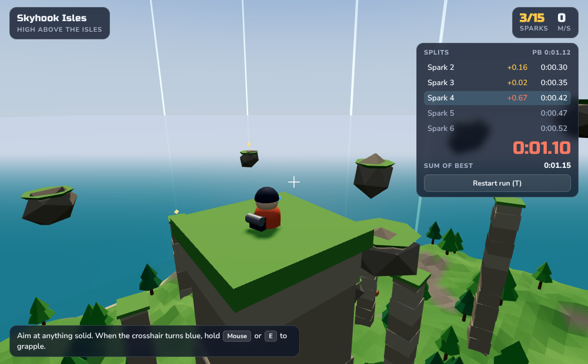

## 2026-11-14: Skyhook Isles, first playable

A third-person 3D grapple game built with Three.js and cannon-es: a generated island, pillars, floating rocks, updrafts and 15 sparks. The rope is a one-sided constraint, and the pull is shared by mass, so crates get yanked and the boulder doesn't.

 

## 2026-11-14: Roquet Royale

A 2D croquet battle royale for the claude.ai artifact room. The host simulates and shares snapshots.
- Free-for-all, with a shrinking lawn.
- Co-op vs bots, with team rings.
- Deathmatch, with K/D.
- Death Run, with a rotating trapper and five traps.
- Ping display.

 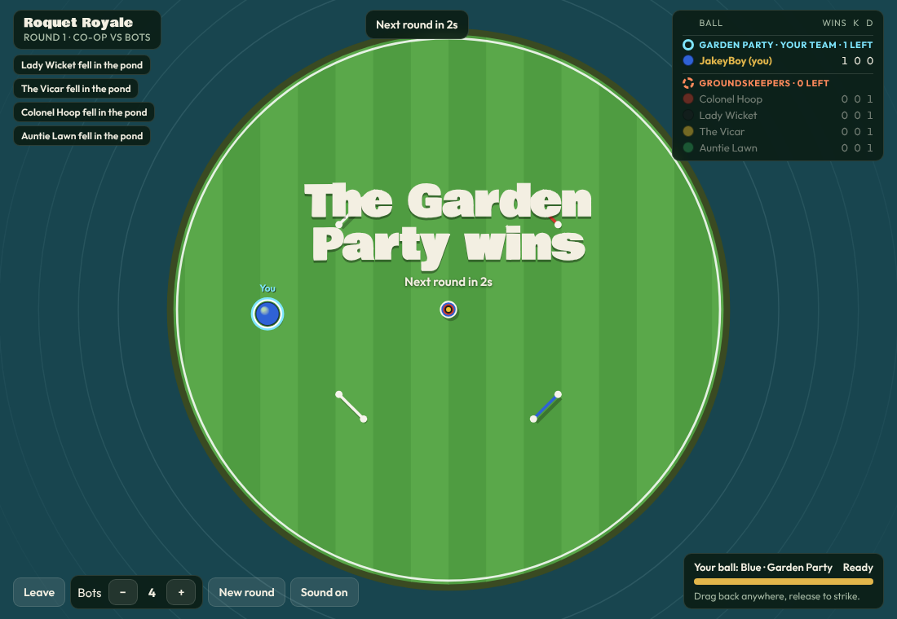  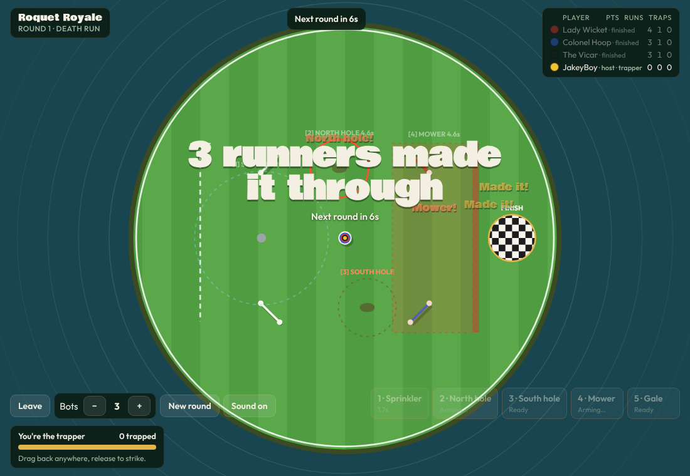

---

## Next up

1. Four themed maps, including a rainy Hong Kong-style city.
2. Cups: pick a pack of 3 maps, with points across them.
3. Leaderboards with initials, shared through the artifact database.
4. Character select, plus a Doom-style reacting face in the HUD.
5. Mario Kart-style race items: a "blue shell" that hunts the leader, and bombs that blow holes in buildings (destructible structures).
6. Graphics push (bloom, water, rain, quality setting).
7. Smarter bots that actually grapple across the map and collect sparks.
