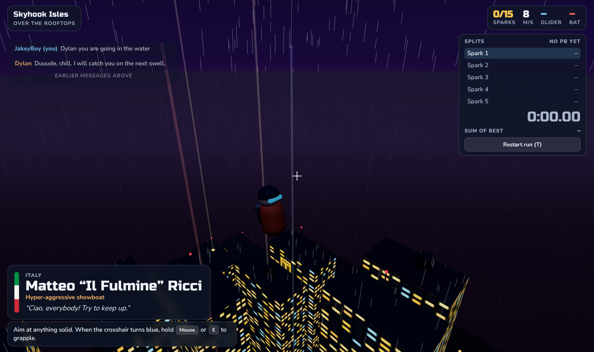
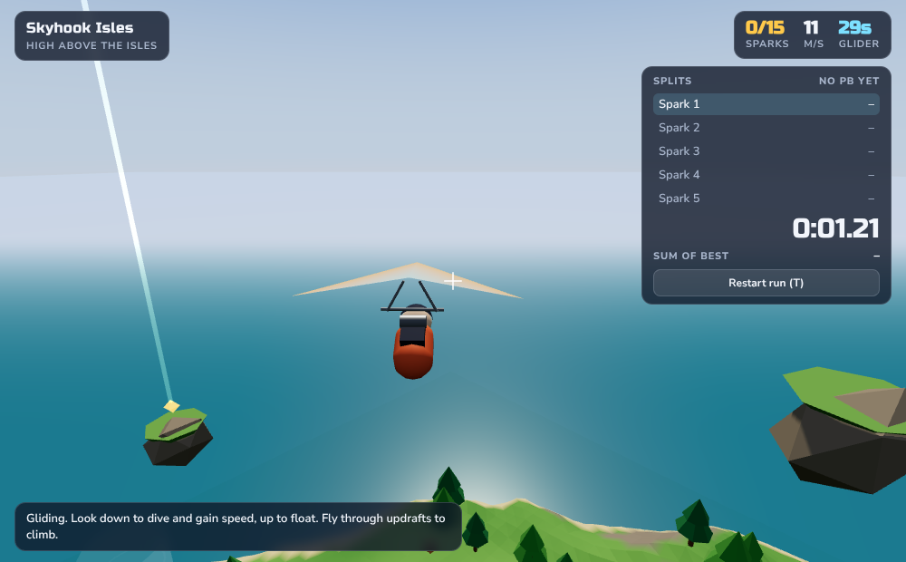
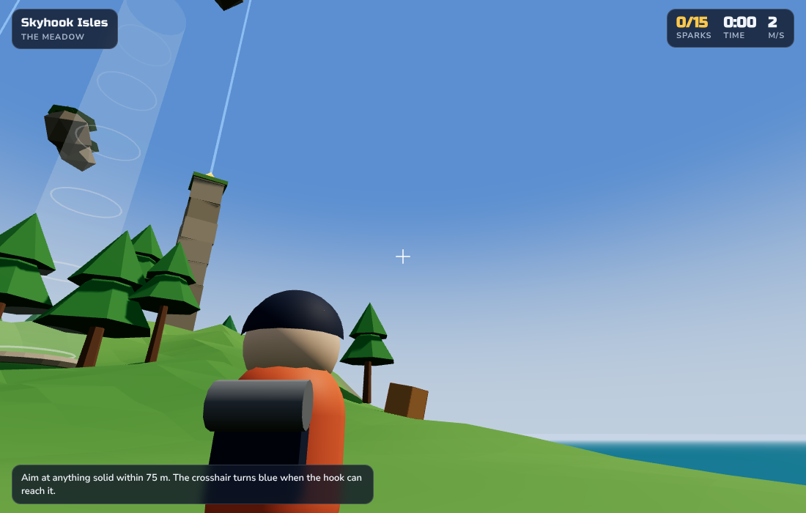
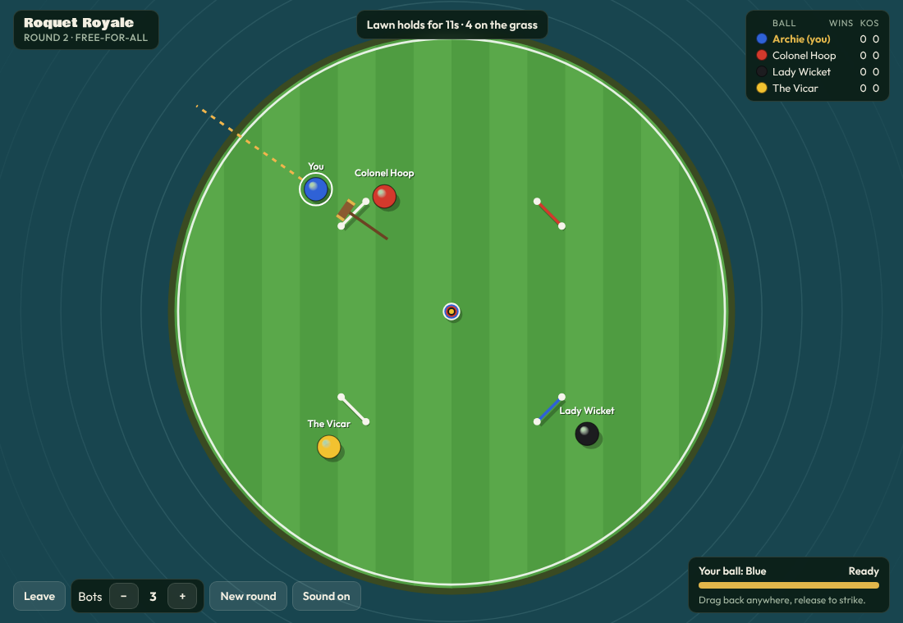

# Design log

Everything built in cOOL-gAMEZ, newest first. Screenshots live in `docs/img/`. Regenerate the current Skyhook ones with `node tools/screenshots.js`.

---

## 2026-11-14 (overnight): Smart bots, four new maps, cups, leaderboards

**Bots race for sparks.** Each bot has its own spark set and a new brain (`botRace` in `js/main.js`):
- It picks the cheapest spark (distance plus climb cost).
- For a spark on a structure, it hooks the structure's near rim, reels in, and pops over the edge.
- For a far spark, it picks stepping anchors and swings between them.
- It brakes in the air to land, catches itself when falling toward the sea, backs off when stuck under a rock, and skips sparks it can't reach for a while.

Personality still decides when they break off to fight or flee.

Bugs found by tracing bots second by second:
- **Rocket loop:** "release when above the anchor" plus an upward boost on every release made bots climb to 180 m.
- **Underside hooking:** aiming under floating rocks got bots reeled into them and flung by the physics.
- **Speed pile-up:** a rope pulling a bot against a wall piled up speed to 1,700 m/s. There's now a hard 45 m/s cap, and bots let go of ropes that aren't pulling them closer.
- **Sleeping bots:** the physics engine put idle bots to sleep, which froze them.

Result: about 1 spark per minute per bot at the start of the night, about 4 per minute now (`npm run bench-bots`).

**Training loop.**
- `npm run train-bots` evolves the 11 swing-technique numbers by simulation and writes `js/bot-params.js`.
- The first version was fooled by noise. Now every evaluation reloads the page for a fresh physics world and seeds the randomness, so the same parameters always score the same.
- Score: sparks minus half the falls, over 3 characters × 3 start points.

**Four new maps** (`maps/*.js`), picked from the start screen:
- **Neon Harbour:** a rainy night city inspired by Hong Kong. Towers with lit windows, neon signs, wet streets, steam-vent updrafts, the harbour around it, rain and lightning with thunder.
- **Ember Caldera:** a volcano in a lava sea. Hexagonal basalt columns, obsidian rocks, ash geysers, rising embers.
- **Glacier Spires:** glowing ice spires, ice floes, slippery ground that keeps your momentum, snow, and northern lights.
- **Scrapyard Canyon:** two mesas split by a gorge. Cranes, stacked wrecks, loose cars to shove, and hanging magnets over the gorge to catch falls.

Each map keeps its own personal bests, and friends on a different map aren't drawn into yours.

 
 

**Cups (Mario Kart style).**
- Pick a map pack and press Start cup. Each race starts automatically with a countdown.
- A race ends when someone collects all 15 sparks, or after 4 minutes.
- Standings rank sparks, then time. Points go 10, 8, 6, 5, 4, 3, 2, 1. Then you go on to the next map.
- After the last map, a final standings screen.
- Map Pack 1 (Sky Cup) is Isles, Neon Harbour and Ember Caldera. Map Pack 2 (Frontier Cup) is Glacier Spires, Scrapyard Canyon and Neon Harbour.
- Cup progress survives the reload between maps.
- Races outside a cup now end with a results screen too.

**Leaderboards.**
- Best full-clear times per map, with 3-letter arcade initials, are stored in the artifact's shared database.
- The board shows on the start screen. Anyone the game is shared with can read it, and Contributors can post.
- Cup point totals post to a cup board.

**Tests.** `npm test` now runs `tools/test-skyhook.js` (26 checks) plus `tools/test-maps.js` (29 checks): every map loads, has 15 sparks and grapple targets, spawns you on dry ground, walks smoothly and spawns moving bots, plus the cup flow end to end.

## 2026-11-14: Chat polish, text-only characters

- **Text only:** characters no longer speak aloud (feedback: the synthetic voices didn't sound good). Their lines appear as speech bubbles and in the chat log. The match announcer stays, with its own toggle.
- **Chat history:** the chat panel keeps the last 60 messages, scrolls, and is saved across reloads.
- **Conversations:** a message without a name goes to whichever character spoke to you in the last 25 s, and each character remembers the last few lines, so back-and-forth chats stay coherent.

## 2026-11-14: Skyhook Isles, map system, chat, outer islets

**Restructure.** The game was one 1,500-line HTML file. It's now split:
- `index.html`: page, styles, HUD
- `js/main.js`: engine: rendering, physics, player, multiplayer, bots, audio
- `js/lib.js`: shared noise and math helpers
- `maps/*.js`: one file per map (terrain height, colors, sky, objects), listed in `maps/index.js`

Maps are picked by URL hash (`#map-isles`) for now. The artifact publishes the extra files alongside the page.

**Expanded Skyhook Isles.**
- The world grew from 240 m to 320 m square.
- Five outer islets, mostly on the far side from spawn, each with a pillar.
- A ring of 18 floating catch-rocks just off the coast, plus stepping rocks out to each islet, so a knock-off or a missed swing can be saved.

**Chat.**
- Enter opens text chat. Hold V (or the Mic button) for voice: the dictation capability turns speech into text.
- When you chat with bots around, the bot you name (or a random one, about 40% of the time) answers in character. The line is written by Claude via the sample capability, spoken in their voice, and shared with friends.

**New character.** Dylan "Swell" Hayes from California: a chill surfer who rides ropes and rarely starts fights. Entrance move: shaka sway.

## 2026-11-14: Skyhook Isles, bots become a cast of characters

Six original characters, each with a nationality, colors, entrance card and move, voice, catchphrases and AI traits (aggression, fear, grapple use, dodge, knockback, grudges). They were inspired by the casts of *Sports Champions* and *Rockstar Table Tennis*. Bots run on one player's game and are shared through presence, with handover when that player pauses or leaves.

## 2026-11-14: Skyhook Isles, combat, sound, music, announcer, tooling

- **Combat:** shove (F) plus a baseball-bat power-up. Hits are numbered events the target applies to itself. Sea dunks are credited to the last hitter within 8 s.
- **Sound effects:** synthesized live.
- **Music:** an original procedural 132 BPM techno track (acid bass, stabs, breakdowns).
- **Announcer:** Claude's voice, or the browser's speech voice, replaceable by recorded clips.
- **Tooling:**
  - `tools/harness.js` serves the repo, swaps the CDN for local libraries, and fakes the multiplayer room.
  - `npm test` runs the regression checks.
  - `npm run voice` bass-boosts announcer recordings with ffmpeg.

## 2026-11-14: Skyhook Isles, multiplayer

Each player runs their own physics and shares a pose about 20 times a second. You can grapple your friend, which pulls both of you. A Start race button gives everyone a 3-2-1 countdown.

## 2026-11-14: Skyhook Isles, movement fixes, glider, speedrun splits

- **Jitter fix:** render interpolated physics poses.
- **Hover ground controller:** replaced the collision sphere scraping over terrain triangles. Vertical speed went from swinging −14 to +2 m/s to staying between −1.7 and +2.5 m/s.
- **Glider power-up:** hold Space while falling. Dive to gain speed; updrafts give lift.
- **LiveSplit-style timer:** per-spark splits, gold segments, a live delta, and sum of best.

 

## 2026-11-14: Skyhook Isles, first playable

A third-person 3D grapple game built with Three.js and cannon-es: a generated island, pillars, floating rocks, updrafts and 15 sparks. The rope is a one-sided constraint, and the pull is shared by mass, so crates get yanked and the boulder doesn't.

 

## 2026-11-14: Roquet Royale

A 2D croquet battle royale for the claude.ai artifact room. The host simulates and shares snapshots.
- Free-for-all, with a shrinking lawn.
- Co-op vs bots, with team rings.
- Deathmatch, with K/D.
- Death Run, with a rotating trapper and five traps.
- Ping display.

   

---

## Next up

1. Four themed maps, including a rainy Hong Kong-style city.
2. Cups: pick a pack of 3 maps, with points across them.
3. Leaderboards with initials, shared through the artifact database.
4. Character select, plus a Doom-style reacting face in the HUD.
5. Mario Kart-style race items: a "blue shell" that hunts the leader, and bombs that blow holes in buildings (destructible structures).
6. Graphics push (bloom, water, rain, quality setting).
7. Smarter bots that actually grapple across the map and collect sparks.
